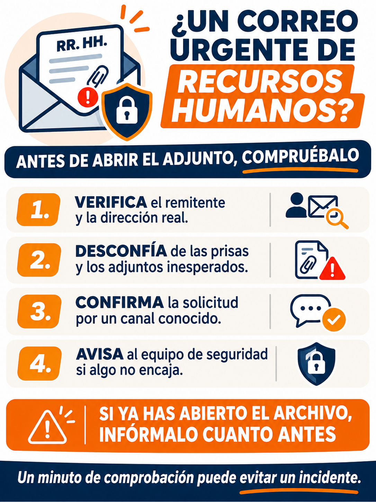
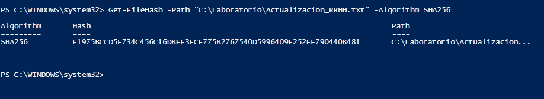
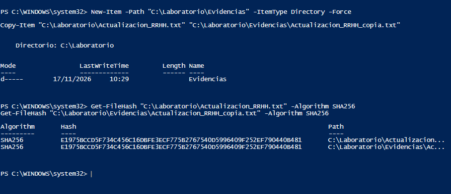
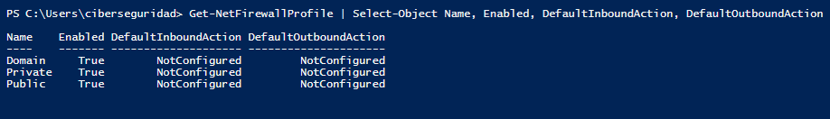
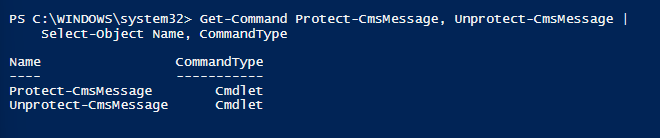
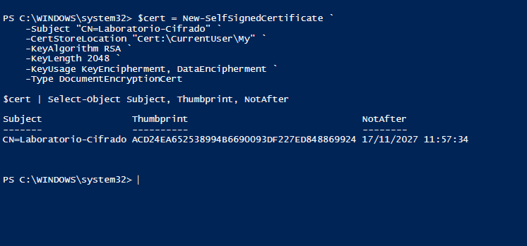
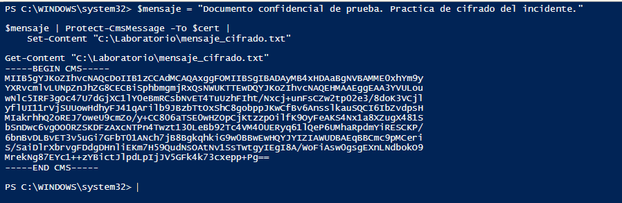
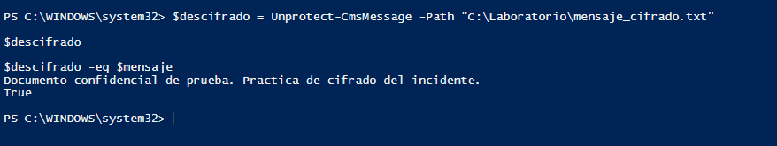

# 01 · Prevención, concienciación y criptografía

**Orden de lectura:** principios y medidas de seguridad → plan de formación → guía para empleados → cartel antiphishing → criptografía y certificados → evidencias técnicas de Defender, firewall y cifrado → conclusión. Las respuestas al enunciado aparecen primero y las prácticas técnicas después. El laboratorio no equivale a una implantación empresarial real.


> **Caso ficticio:** empresa de aproximadamente cien personas. Los apartados de política y formación son propuestas; las capturas de Windows y la comprobación SHA-256 son pruebas reales del laboratorio.

## 1. Caso, principios de seguridad y medidas de protección

### Introducción

El incidente planteado en clase comienza con un correo que aparenta proceder de Recursos Humanos. Un empleado abre el archivo adjunto y después surgen alertas del antivirus, conexiones de red extrañas, intentos de acceso a carpetas compartidas y sospechas sobre una posible filtración de datos personales.

Este caso sirve para explicar que la prevención no es solo instalar programas de seguridad: también importa **cómo trabajan las personas, qué normas existen y cómo se toman decisiones cuando aparece una señal de alerta**. He organizado el apartado siguiendo los conceptos del material docente: principios de seguridad, prevención, protección del puesto, concienciación y criptografía.

### Principios fundamentales

**Confidencialidad.** Los datos solo deben ser accesibles a las personas autorizadas. En el escenario, la información de los clientes es uno de los activos que más debemos proteger.

**Integridad.** Los documentos y registros no pueden modificarse sin autorización. Para comprobar que el adjunto de laboratorio no cambió durante su copia se utilizó SHA-256.

**Disponibilidad.** Los trabajadores deben poder seguir utilizando los servicios esenciales. La empresa necesita copias de seguridad, alternativas y procedimientos de recuperación ante una infección.

Además, hacen falta mecanismos de autenticación, autorización y trazabilidad para relacionar las acciones con cuentas, servicios y momentos concretos.

### Riesgos y medidas de prevención

| Riesgo del caso | Posible consecuencia | Prevención propuesta |
|---|---|---|
| Suplantación aparente de Recursos Humanos | El empleado confía en un mensaje falso | Formación, verificación por otro canal y protección del correo |
| Apertura de adjuntos | Ejecución de código malicioso | Filtrado, control de aplicaciones, actualizaciones y antivirus |
| Cuentas comprometidas | Acceso indebido a servicios | MFA, permisos mínimos y gestión de contraseñas |
| Movimiento por carpetas compartidas | Afectación de otros archivos o equipos | Segmentación y revisión de permisos SMB |
| Conexiones hacia destinos sospechosos | Comunicación con infraestructura no autorizada | Monitorización, firewall y análisis de registros |
| Acceso a datos de clientes | Riesgo de exposición de información personal | Cifrado, controles de acceso y procedimientos de notificación |
| Interrupción de servicios | Pérdida de disponibilidad | Copias protegidas y pruebas de restauración |

Se trata de **medidas recomendadas**, no de controles cuya implantación se haya comprobado en la empresa ficticia.

El plan detallado, la formación y las normas internas se incluyen a continuación.

## 2. Plan de prevención y formación de la plantilla

#### 1. Punto de partida

El plan propuesto se basa en **personas, procesos y tecnología**. Como la empresa ficticia no dispone de un procedimiento formal, estas medidas son propuestas de mejora, no actuaciones ya implantadas.

Los principios de confidencialidad, integridad y disponibilidad se han explicado en el punto anterior. En este plan los aplico a los permisos, las copias de seguridad, el cifrado y el control de cambios.

#### 3. Debilidades que debemos revisar

**Humanas.** Abrir adjuntos inesperados, confiar en la autoridad aparente de Recursos Humanos, reutilizar contraseñas o no saber dónde comunicar un problema.

**Técnicas.** Sistemas sin actualizar, protección desactivada, macros sin restricciones, accesos excesivos a carpetas compartidas, falta de segmentación y registros insuficientes.

**Organizativas.** Ausencia de un protocolo de aviso, formación esporádica, responsables poco definidos, copias sin pruebas de restauración o falta de revisión de permisos.

Estas son **posibles debilidades a evaluar**, no hallazgos demostrados en la empresa ficticia.

#### 4. Política mínima para los puestos de trabajo

1. **Cuentas y privilegios.** Cada persona utiliza una cuenta propia y acceso solo a los recursos necesarios; administración separada y justificada.
2. **Identidades.** MFA en servicios compatibles, contraseñas robustas y gestor autorizado. No se comparten credenciales.
3. **Actualizaciones.** Sistemas operativos, navegador, lector de documentos y antivirus actualizados.
4. **Correo.** Filtrado de adjuntos, comprobaciones SPF/DKIM/DMARC cuando proceda y bloqueo de tipos de archivo de alto riesgo. Ningún filtro garantiza detectar el 100 % de los mensajes.
5. **Aplicaciones.** Software autorizado, control de macros y bloqueo de ejecución de archivos desconocidos conforme a la política empresarial.
6. **Dispositivos y USB.** Solo medios y periféricos permitidos; bloqueo de pantalla y cifrado de portátiles.
7. **Red.** Firewall activo, segmentación, servicios innecesarios deshabilitados y carpetas compartidas limitadas por permisos.
8. **Copias y recuperación.** Copias protegidas, retención definida y restauraciones de prueba.
9. **Registros.** Auditoría habilitada y acceso restringido a logs.
10. **Notificación.** Ante un correo sospechoso se avisa por un canal oficial; no se borra ni se reenvía indiscriminadamente.

#### 5. Formación para aproximadamente cien empleados

**Objetivo general:** que cualquier trabajador sepa reconocer señales habituales de phishing, sepa qué no debe hacer y conozca cómo avisar rápidamente.

| Momento | Actividad | Público | Cómo comprobarla |
|---|---|---|---|
| Inicio | Sesión de 45 minutos: correo falso de RR. HH., enlaces, adjuntos, contraseñas y notificación | Toda la plantilla | Asistencia y cuestionario |
| Semana siguiente | Guía breve por correo y cartel en zonas comunes o intranet | Toda la plantilla | Confirmar difusión |
| Cada trimestre | Microformación de 10–15 minutos | Toda la plantilla | Preguntas de repaso |
| Semestralmente | Simulación educativa de phishing, sin adjuntos peligrosos ni recogida de contraseñas | Usuarios autorizados por la organización | Porcentaje de aviso, dudas recurrentes y aprendizaje |
| Anualmente | Repaso de procedimientos, mejoras y nuevas amenazas | Empleados y responsables | Encuesta y revisión del plan |

### Adaptación por perfiles

- **Personal general:** señales de phishing, enlaces, adjuntos y reporte.
- **Recursos Humanos y Finanzas:** suplantación de responsables y solicitudes de cambios de datos o pagos.
- **Administradores de sistemas:** privilegios, registros, accesos remotos, copias y respuesta inicial.
- **Dirección:** criterios de escalado, decisiones y continuidad.

### Indicadores para evaluar el plan

Mediremos la participación, los aciertos en cuestionarios, el porcentaje de comunicaciones correctamente notificadas y el tiempo de aviso durante ejercicios. Se compararán resultados antes y después de la formación; **no se inventarán porcentajes**, porque todavía no hemos impartido el programa.

### Respuesta ante un mensaje sospechoso

1. No abrir el adjunto ni pulsar enlaces.
2. Verificar la solicitud mediante un canal conocido, no respondiendo al propio mensaje.
3. Comunicar la incidencia al canal interno de seguridad o soporte.
4. Conservar el correo y seguir instrucciones; no eliminar pruebas ni intentar investigar por cuenta propia.
5. Si el archivo ya se abrió, comunicarlo inmediatamente y seguir las indicaciones de contención del equipo técnico.

### Conclusión

La finalidad no es conseguir que nadie se equivoque nunca, sino disminuir la probabilidad de error y lograr que un aviso temprano permita actuar antes de que el problema se propague. En el caso planteado, una verificación independiente de la supuesta petición de Recursos Humanos habría sido una barrera importante.

**Referencia de temario:** [Incidentes de ciberseguridad, material de clase](https://www.jesusninoc.com/09/30/incidentes-de-ciberseguridad/), bloque 1: prevención, principios de seguridad, equipos y formación.

## 3. Guía práctica para los empleados

**Empresa ficticia del caso — Material de concienciación**

### Antes de abrir un mensaje o archivo

**1. Comprobar quién escribe.** El nombre visible puede ser «Recursos Humanos», pero eso no demuestra quién ha enviado realmente el mensaje. Hay que revisar la dirección y comprobar si se esperaba esa comunicación.

**2. Desconfiar de la urgencia inesperada.** Mensajes como «antes de finalizar la jornada» pueden utilizar la presión para evitar que pensemos.

**3. Revisar la petición.** Una actualización de nóminas, datos bancarios o contraseñas debería seguir los procedimientos habituales. Si el mensaje pide saltarse esos procedimientos, es una señal de alerta.

**4. No abrir adjuntos inesperados.** Ni siquiera cuando tienen nombres aparentemente normales. Los ficheros comprimidos, ejecutables y documentos que piden habilitar contenido merecen especial atención.

**5. Comprobar por otro canal.** Llamar a Recursos Humanos con el número que ya conocemos o consultar la intranet; no utilizar el teléfono ni el enlace proporcionado en el mensaje dudoso.

### Si sospechas de phishing

- No contestes, no sigas enlaces y no abras el adjunto.
- Utiliza el canal corporativo de reporte o informa al equipo de soporte.
- Indica cuándo lo recibiste, el remitente aparente, el asunto y si has abierto algo.
- Conserva el mensaje siguiendo las instrucciones del personal responsable.

### Si ya has abierto el archivo

- Comunícalo **de inmediato**, aunque no haya aparecido ninguna alerta.
- No borres mensajes ni archivos para «limpiar» el equipo.
- No desactives el antivirus ni intentes arreglarlo por tu cuenta.
- Sigue las instrucciones del equipo técnico sobre aislamiento, cambio de credenciales y revisión.

### Ejemplo de nuestro laboratorio

El correo ficticio creado durante la práctica aparenta proceder de `rrhh@empresa-ejemplo.invalid`, utiliza el asunto **«Actualización urgente de datos de empleado»** y pide abrir `Actualizacion_RRHH.txt`.

Estas señales justifican **verificar** la petición y comunicar la sospecha. El archivo del laboratorio es deliberadamente inocuo; **no se ha enviado un ataque real**.

### Mensaje final

**Si un correo te mete prisa, dedica un momento a comprobarlo. Avisar a tiempo también es una medida de seguridad.**

## 4. Cartel antiphishing para la plantilla

**Material de concienciación diseñado para una empresa ficticia de unos cien empleados.** Este archivo recoge el texto definitivo del cartel para poder utilizarlo en la intranet, enviarlo por correo o convertirlo posteriormente en una imagen imprimible.

---

### ¿RECURSOS HUMANOS TE PIDE ALGO URGENTE?

### NO ABRAS EL ADJUNTO SIN COMPROBARLO

**1. VERIFICA** quién envía realmente el mensaje.

**2. DESCONFÍA** de una urgencia inesperada.

**3. CONFIRMA** la petición por teléfono o por un canal conocido.

**4. AVISA** al equipo de seguridad si algo no encaja.

> **SI YA HAS ABIERTO EL ARCHIVO, INFÓRMALO CUANTO ANTES.**

**Un minuto de comprobación puede evitar un incidente.**

---

### Justificación del diseño

El cartel se centra en el vector de entrada del caso: un correo que aparenta proceder de Recursos Humanos. Utiliza una pregunta inicial para captar la atención y cuatro verbos fáciles de recordar. Evita culpar a la persona que cometió el error; lo importante es que comunique el incidente para reducir su impacto.

**Formato recomendado:** A4 vertical, tipografía grande, contraste alto, cuatro acciones visibles y un canal corporativo real de aviso cuando la empresa lo defina. **No inventamos un teléfono ni una dirección de contacto.**

**Cartel elaborado:** además del texto, se ha incorporado una versión gráfica. Recuerda verificar el remitente, desconfiar de adjuntos inesperados, confirmar por otro canal y avisar si ya se abrió un archivo sospechoso.



## 5. Criptografía y certificados

#### 1. Por qué importa en este caso

El escenario incluye un posible acceso a información de clientes y un archivo que necesitamos conservar como evidencia. La criptografía ayuda a proteger la confidencialidad, verificar la integridad y comprobar determinadas identidades, aunque **no sustituye** a la formación y al control de accesos.

#### 2. Cifrado simétrico

Se usa una misma clave secreta para cifrar y descifrar datos. Por ejemplo, **AES** se utiliza habitualmente para proteger información almacenada o transmitida. Su ventaja es la eficiencia al trabajar con cantidades grandes de datos. Su dificultad principal consiste en gestionar y distribuir la clave sin exponerla.

**Aplicación al caso:** cifrado de equipos portátiles, discos y copias de seguridad para reducir consecuencias si alguien obtiene acceso físico al dispositivo. La protección depende también de cómo se gestionen las claves.

#### 3. Cifrado asimétrico

Utiliza un par de claves, una pública y otra privada, con funciones distintas. Según el algoritmo y el protocolo, permite cifrar pequeñas piezas de información, establecer mecanismos de intercambio de claves o crear firmas digitales. No significa que todos los sistemas asimétricos sirvan indistintamente para cada uso.

**Aplicación al caso:** comunicaciones autenticadas y servicios internos que utilizan claves públicas y certificados.

#### 4. Diferencia entre cifrar, hacer hash y firmar

| Técnica | Para qué sirve | ¿Se puede recuperar el texto original? | Ejemplo |
|---|---|---|---|
| Cifrado | Mantener información confidencial | Sí, con la clave adecuada | AES |
| Hash criptográfico | Obtener una huella para comprobar integridad | No está diseñado para recuperar el original | SHA-256 |
| Firma digital | Comprobar que la firma corresponde a la clave y que el contenido no ha cambiado | No es un mecanismo de cifrado del documento | Firma con clave privada |

Un hash coincidente es una prueba sólida de igualdad de contenido en el contexto de la práctica, pero **no prueba por sí solo quién creó el archivo ni que no sea peligroso**.

### Práctica real realizada con SHA-256

En Windows 11 ejecuté:

```powershell
Get-FileHash -Path "C:\Laboratorio\Actualizacion_RRHH.txt" -Algorithm SHA256
```



Después comparé el original y su copia:

```powershell
Get-FileHash "C:\Laboratorio\Actualizacion_RRHH.txt" -Algorithm SHA256
Get-FileHash "C:\Laboratorio\Evidencias\Actualizacion_RRHH_copia.txt" -Algorithm SHA256
```



Los hashes coincidieron. La práctica se explica con más detalle en [cálculo y comprobación de SHA-256](../03-investigacion/README.md#6-calcular-el-hash-sha-256-y-explicar-su-utilidad).

#### 5. Firmas digitales

Una firma digital se crea utilizando una clave privada y puede verificarse mediante la clave pública correspondiente. Permite detectar cambios en el contenido firmado y verificar la relación con el titular de la clave, siempre que esa relación sea fiable. **No debe confundirse con insertar una imagen de una firma manuscrita.**

En un correo empresarial, la firma y la validación de identidad pueden reforzar la confianza, aunque sigue siendo necesario revisar el contexto del mensaje.

#### 6. Certificados digitales y PKI

Un certificado digital relaciona datos de identidad con una clave pública. Una **PKI (infraestructura de clave pública)** establece los componentes y procedimientos que hacen posible emitir, validar y revocar certificados: autoridades de certificación, registros, políticas y mecanismos para comprobar la vigencia.

Por ejemplo, cuando el navegador se conecta a un portal mediante HTTPS, valida el certificado del servidor dentro de una cadena de confianza. Un certificado válido del sitio **no significa** que cualquier documento que aparezca en él sea seguro.

#### 7. Diffie-Hellman

Diffie-Hellman permite que dos participantes acuerden un secreto compartido a través de un canal que puede ser observado. Los valores públicos no revelan directamente el secreto privado. Sus versiones modernas se utilizan en protocolos de comunicación segura.

**Limitación:** Diffie-Hellman sin autenticación es vulnerable a un intermediario que suplante a uno de los extremos. Por eso se integra en protocolos que también verifican la identidad de los participantes.

#### 8. Relación con las necesidades de la empresa

| Necesidad | Mecanismo orientativo |
|---|---|
| Proteger portátiles y copias | Cifrado simétrico del almacenamiento |
| Mantener comunicación segura con servicios | TLS, certificados y mecanismos criptográficos adecuados |
| Comprobar que una evidencia no cambió | SHA-256 |
| Verificar documentos firmados | Firma digital y validación de certificados |
| Establecer secretos de sesión | Intercambio de claves autenticado |

### Conclusión

En el laboratorio hemos **aplicado SHA-256** y, como práctica complementaria, cifrado y descifrado un texto con CMS y un certificado autofirmado. Los demás mecanismos se han explicado teóricamente: no afirmo haber configurado una PKI corporativa ni firmado documentos. La idea clave es elegir cada mecanismo según el objetivo: confidencialidad, integridad o autenticidad.

**Referencia docente:** [Incidentes de ciberseguridad, bloque 1](https://www.jesusninoc.com/09/30/incidentes-de-ciberseguridad/).

## 6. Comprobaciones reales de Microsoft Defender y firewall

Para comprobar parte de la protección de la máquina virtual `W11_Incidente`, utilicé PowerShell.

### Microsoft Defender

```powershell
Get-MpComputerStatus | Select-Object AMServiceEnabled, AntivirusEnabled, RealTimeProtectionEnabled, AntivirusSignatureLastUpdated
```


Este comando permite consultar el estado del servicio antivirus, la protección en tiempo real y la última actualización de firmas. La captura conserva la salida real de la práctica.

En una comprobación posterior, `Get-MpThreatDetection` no devolvió detecciones. Se solicitó un análisis del adjunto inocuo, pero **no se encontró confirmación de su finalización en los eventos 1000 y 1001 del día de la prueba**. Por tanto, no lo presento como una prueba de detección efectiva de malware.

### Firewall de Windows

```powershell
Get-NetFirewallProfile | Select-Object Name, Enabled, DefaultInboundAction, DefaultOutboundAction
```



Los tres perfiles —`Domain`, `Private` y `Public`— aparecieron habilitados (`True`). Las acciones predeterminadas figuraban como `NotConfigured`, lo que no significa que el firewall esté desactivado.

Estas comprobaciones corresponden al **estado inicial del laboratorio**, no al funcionamiento de la empresa del enunciado.

## 7. Práctica de cifrado y descifrado con un certificado de laboratorio

### 7.1. Objetivo y entorno

Para complementar la práctica del hash SHA-256, realicé una demostración de **cifrado y descifrado de un mensaje de texto** desde PowerShell, en la misma máquina virtual Windows 11. Se empleó exclusivamente información ficticia, con un certificado autofirmado del usuario actual.

La finalidad es distinguir **integridad mediante hash** de **confidencialidad mediante cifrado**. En esta práctica, CMS protege un mensaje para el certificado destinatario; no se trata de cifrar el disco, enviar un correo real ni desplegar una PKI corporativa.

### 7.2. Comprobación de los comandos disponibles

```powershell
Get-Command Protect-CmsMessage, Unprotect-CmsMessage |
    Select-Object Name, CommandType
```

**Resultado observado:** aparecieron `Protect-CmsMessage` y `Unprotect-CmsMessage` como comandos de tipo `Cmdlet`. Se comprobó su disponibilidad, no el funcionamiento del cifrado todavía.



### 7.3. Creación del certificado

```powershell
$cert = New-SelfSignedCertificate `
    -Subject "CN=Laboratorio-Cifrado" `
    -CertStoreLocation "Cert:\CurrentUser\My" `
    -KeyAlgorithm RSA `
    -KeyLength 2048 `
    -KeyUsage KeyEncipherment, DataEncipherment `
    -Type DocumentEncryptionCert

$cert | Select-Object Subject, Thumbprint, NotAfter
```

**Resultado observado:** se creó el certificado `CN=Laboratorio-Cifrado`, con clave RSA de 2048 bits y caducidad **17/11/2027**. Se almacenó en el almacén de certificados personal del usuario actual. Un certificado autofirmado sirve para este laboratorio, pero no equivale a un certificado de confianza pública.



### 7.4. Cifrado del mensaje con CMS

```powershell
$mensaje = "Documento confidencial de prueba. Practica de cifrado del incidente."

$mensaje | Protect-CmsMessage -To $cert |
    Set-Content "C:\Laboratorio\mensaje_cifrado.txt"

Get-Content "C:\Laboratorio\mensaje_cifrado.txt"
```

**Resultado observado:** se generó un bloque con las marcas `-----BEGIN CMS-----` y `-----END CMS-----`, almacenado en el fichero `C:\Laboratorio\mensaje_cifrado.txt`. Su contenido no muestra el texto original directamente. No se publica el bloque completo, porque no hace falta para explicar el procedimiento.



### 7.5. Descifrado y verificación

```powershell
$descifrado = Unprotect-CmsMessage -Path "C:\Laboratorio\mensaje_cifrado.txt"

$descifrado

$descifrado -eq $mensaje
```

**Resultado real:**

```text
Documento confidencial de prueba. Practica de cifrado del incidente.
True
```

La comparación `True` demuestra que se recuperó el **mismo texto original** al descifrar el mensaje con las credenciales criptográficas disponibles en el equipo. No demuestra por sí sola la seguridad de toda una infraestructura de correo ni la identidad de usuarios remotos.



### 7.6. Resultado y aprendizaje

La operación de cifrado y descifrado ha funcionado en el laboratorio. A diferencia de SHA-256, que produce una huella para verificar integridad, el cifrado permite recuperar el texto original si se dispone del material criptográfico adecuado. El certificado y su clave privada deben protegerse; en un caso real sería necesario aplicar políticas de emisión, custodia, renovación y revocación.

**Evidencias:** las imágenes están incorporadas a `01-prevencion/capturas/` y muestran la salida real de los comandos.

## 8. Conclusión del apartado

Con el ejercicio he comprobado el estado inicial de algunas protecciones de Windows y he relacionado la comprobación de integridad con el apartado de investigación. La prevención en la empresa depende también de personas formadas, controles de acceso, actualización de equipos, protección del correo y una manera clara de avisar.

El cartel incluido en el punto 4 es un material diseñado para este caso; no se afirma que la formación se haya impartido realmente ni que exista una PKI empresarial. La demostración de cifrado y descifrado CMS y sus cuatro capturas ya están documentadas.

### Fuentes consultadas

- [Material docente de incidentes de ciberseguridad](https://www.jesusninoc.com/09/30/incidentes-de-ciberseguridad/).
- [Fuentes del proyecto](../FUENTES.md).

Clases relacionadas con este apartado: [12 de octubre · Prevención y concienciación](https://github.com/jesusninoc/ClasesMasterCiberseguridad/blob/main/2026/2026-10-12.md) y [19 de octubre · Criptografía y certificados](https://github.com/jesusninoc/ClasesMasterCiberseguridad/blob/main/2026/2026-10-19.md).
