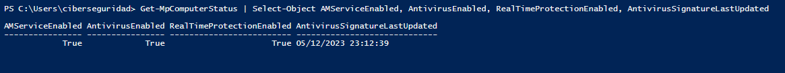

# 01 · Prevención y concienciación

## 1. Contexto y riesgos
El caso plantea un correo que parece proceder del departamento de Recursos Humanos de una empresa ficticia de aproximadamente cien empleados. Un trabajador abre un adjunto y después se observan alertas antivirus, conexiones de red no habituales, accesos a recursos compartidos y una posible exposición de datos personales.

Se trata de una combinación de **ingeniería social, riesgo de ejecución de malware, posible movimiento lateral y posible fuga de información**. Es importante separar lo que afirma el enunciado de lo que se ha demostrado en las máquinas virtuales.

## 2. Medidas preventivas propuestas
Para reducir las posibilidades de que un correo así cause un incidente, propongo:

1. Mantener Windows, navegadores y aplicaciones actualizados.
2. Utilizar antivirus activo, firewall y protección en tiempo real.
3. Trabajar con cuentas sin privilegios de administración salvo necesidad justificada.
4. Aplicar autenticación multifactor, contraseñas robustas y permisos mínimos.
5. Limitar el acceso a carpetas compartidas según las funciones de cada empleado.
6. Filtrar adjuntos, enlaces y suplantaciones de remitente en el correo corporativo.
7. Disponer de copias de seguridad verificadas y procedimientos de restauración.
8. Facilitar un canal sencillo para avisar de mensajes sospechosos.

## 3. Concienciación para cien empleados
Una formación breve y recurrente es más útil que limitarse a una charla anual. Propongo una sesión inicial de 45 minutos con ejemplos de correos fraudulentos, recordatorios trimestrales y ejercicios simulados con fines educativos. La actividad debe medir, al menos, participación, capacidad de reconocer señales de alerta y notificación correcta; nunca debe utilizarse para señalar públicamente a los empleados.

**Guía de actuación ante un correo sospechoso:**
- Comprobar con calma el remitente real y el contexto del mensaje.
- Desconfiar de peticiones inesperadas y de la presión por actuar inmediatamente.
- No abrir adjuntos ni introducir contraseñas desde enlaces dudosos.
- Confirmar la petición con Recursos Humanos por un canal conocido.
- Avisar al equipo de seguridad y conservar el mensaje sin manipularlo.

**Texto para el cartel antiphishing:**

> **¿Un mensaje urgente de Recursos Humanos? Compruébalo antes de abrir.**  
> Verifica el remitente · No abras adjuntos inesperados · Confirma por otro canal · Informa a seguridad.

El cartel definitivo como pieza visual está pendiente de diseñar.

## 4. Criptografía relacionada con el incidente
- **Cifrado simétrico:** la misma clave cifra y descifra (por ejemplo, AES). Es adecuado para proteger datos almacenados y transferencias voluminosas.
- **Cifrado asimétrico:** utiliza claves pública y privada (por ejemplo, RSA o criptografía de curva elíptica). Permite ciertos mecanismos de intercambio de claves y firmas digitales.
- **Hash criptográfico:** SHA-256 calcula una huella para verificar integridad; **no cifra** ni permite recuperar el contenido.
- **Firma digital:** vincula una operación de firma con una clave privada y permite comprobar la integridad y autenticidad mediante la clave pública correspondiente.
- **Certificados y PKI:** una infraestructura de clave pública relaciona identidades y claves públicas mediante certificados y autoridades de certificación.
- **Diffie-Hellman:** permite acordar material secreto a través de un canal inseguro cuando se usa dentro de un protocolo correctamente autenticado; por sí solo no garantiza la identidad de los participantes.

En nuestro laboratorio aplicamos **SHA-256** al adjunto ficticio. Puede consultarse el procedimiento real en [la práctica de integridad](../03-investigacion/practica-hash.md).

## 5. Comprobaciones prácticas de protección en Windows
Durante la auditoría inicial ejecuté:

```powershell
Get-MpComputerStatus | Select-Object AMServiceEnabled, AntivirusEnabled, RealTimeProtectionEnabled, AntivirusSignatureLastUpdated
```



```powershell
Get-NetFirewallProfile | Select-Object Name, Enabled, DefaultInboundAction, DefaultOutboundAction
```


Los tres perfiles aparecieron habilitados. Las capturas representan el estado del equipo, **no una prueba de protección frente a cualquier amenaza**.

## 6. Conclusión
La prevención combina configuraciones técnicas y hábitos de trabajo. En el escenario propuesto, detectar la presión y verificar la supuesta comunicación de Recursos Humanos antes de abrir el adjunto habría reducido el riesgo. Quedan por completar los materiales gráficos definitivos y cualquier prueba adicional específica de cifrado y certificados.
