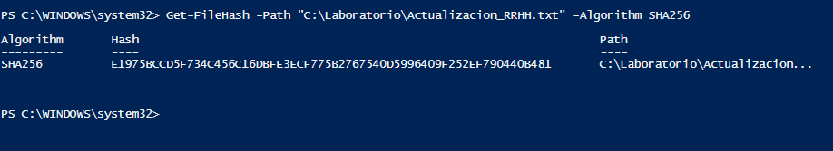
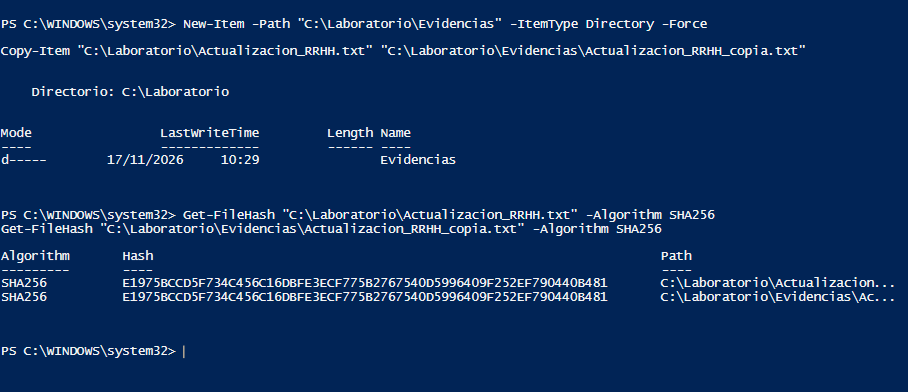

# Criptografía aplicada a la prevención y a la investigación

## 1. Por qué importa en este caso

El escenario incluye un posible acceso a información de clientes y un archivo que necesitamos conservar como evidencia. La criptografía ayuda a proteger la confidencialidad, verificar la integridad y comprobar determinadas identidades, aunque **no sustituye** a la formación y al control de accesos.

## 2. Cifrado simétrico

Se usa una misma clave secreta para cifrar y descifrar datos. Por ejemplo, **AES** se utiliza habitualmente para proteger información almacenada o transmitida. Su ventaja es la eficiencia al trabajar con cantidades grandes de datos. Su dificultad principal consiste en gestionar y distribuir la clave sin exponerla.

**Aplicación al caso:** cifrado de equipos portátiles, discos y copias de seguridad para reducir consecuencias si alguien obtiene acceso físico al dispositivo. La protección depende también de cómo se gestionen las claves.

## 3. Cifrado asimétrico

Utiliza un par de claves, una pública y otra privada, con funciones distintas. Según el algoritmo y el protocolo, permite cifrar pequeñas piezas de información, establecer mecanismos de intercambio de claves o crear firmas digitales. No significa que todos los sistemas asimétricos sirvan indistintamente para cada uso.

**Aplicación al caso:** comunicaciones autenticadas y servicios internos que utilizan claves públicas y certificados.

## 4. Diferencia entre cifrar, hacer hash y firmar

| Técnica | Para qué sirve | ¿Se puede recuperar el texto original? | Ejemplo |
|---|---|---|---|
| Cifrado | Mantener información confidencial | Sí, con la clave adecuada | AES |
| Hash criptográfico | Obtener una huella para comprobar integridad | No está diseñado para recuperar el original | SHA-256 |
| Firma digital | Comprobar que la firma corresponde a la clave y que el contenido no ha cambiado | No es un mecanismo de cifrado del documento | Firma con clave privada |

Un hash coincidente es una prueba sólida de igualdad de contenido en el contexto de la práctica, pero **no prueba por sí solo quién creó el archivo ni que no sea peligroso**.

### Práctica real realizada con SHA-256

En Windows 11 ejecuté:

```powershell
Get-FileHash -Path "C:\Laboratorio\Actualizacion_RRHH.txt" -Algorithm SHA256
```



Después comparé el original y su copia:

```powershell
Get-FileHash "C:\Laboratorio\Actualizacion_RRHH.txt" -Algorithm SHA256
Get-FileHash "C:\Laboratorio\Evidencias\Actualizacion_RRHH_copia.txt" -Algorithm SHA256
```



Los hashes coincidieron. La práctica se explica con más detalle en [integridad de evidencias](../03-investigacion/practica-hash.md).

## 5. Firmas digitales

Una firma digital se crea utilizando una clave privada y puede verificarse mediante la clave pública correspondiente. Permite detectar cambios en el contenido firmado y verificar la relación con el titular de la clave, siempre que esa relación sea fiable. **No debe confundirse con insertar una imagen de una firma manuscrita.**

En un correo empresarial, la firma y la validación de identidad pueden reforzar la confianza, aunque sigue siendo necesario revisar el contexto del mensaje.

## 6. Certificados digitales y PKI

Un certificado digital relaciona datos de identidad con una clave pública. Una **PKI (infraestructura de clave pública)** establece los componentes y procedimientos que hacen posible emitir, validar y revocar certificados: autoridades de certificación, registros, políticas y mecanismos para comprobar la vigencia.

Por ejemplo, cuando el navegador se conecta a un portal mediante HTTPS, valida el certificado del servidor dentro de una cadena de confianza. Un certificado válido del sitio **no significa** que cualquier documento que aparezca en él sea seguro.

## 7. Diffie-Hellman

Diffie-Hellman permite que dos participantes acuerden un secreto compartido a través de un canal que puede ser observado. Los valores públicos no revelan directamente el secreto privado. Sus versiones modernas se utilizan en protocolos de comunicación segura.

**Limitación:** Diffie-Hellman sin autenticación es vulnerable a un intermediario que suplante a uno de los extremos. Por eso se integra en protocolos que también verifican la identidad de los participantes.

## 8. Relación con las necesidades de la empresa

| Necesidad | Mecanismo orientativo |
|---|---|
| Proteger portátiles y copias | Cifrado simétrico del almacenamiento |
| Mantener comunicación segura con servicios | TLS, certificados y mecanismos criptográficos adecuados |
| Comprobar que una evidencia no cambió | SHA-256 |
| Verificar documentos firmados | Firma digital y validación de certificados |
| Establecer secretos de sesión | Intercambio de claves autenticado |

## Conclusión

En esta práctica hemos **aplicado SHA-256**, pero los restantes mecanismos se han explicado teóricamente: no afirmamos haber configurado una PKI, firmado documentos o implantado cifrado corporativo. La idea clave es elegir cada mecanismo según el objetivo: confidencialidad, integridad o autenticidad.

**Referencia docente:** [Incidentes de ciberseguridad, bloque 1](https://www.jesusninoc.com/09/30/incidentes-de-ciberseguridad/).
