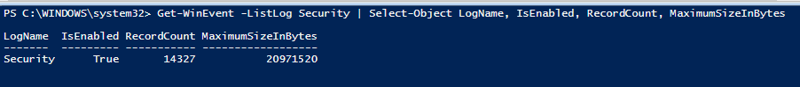
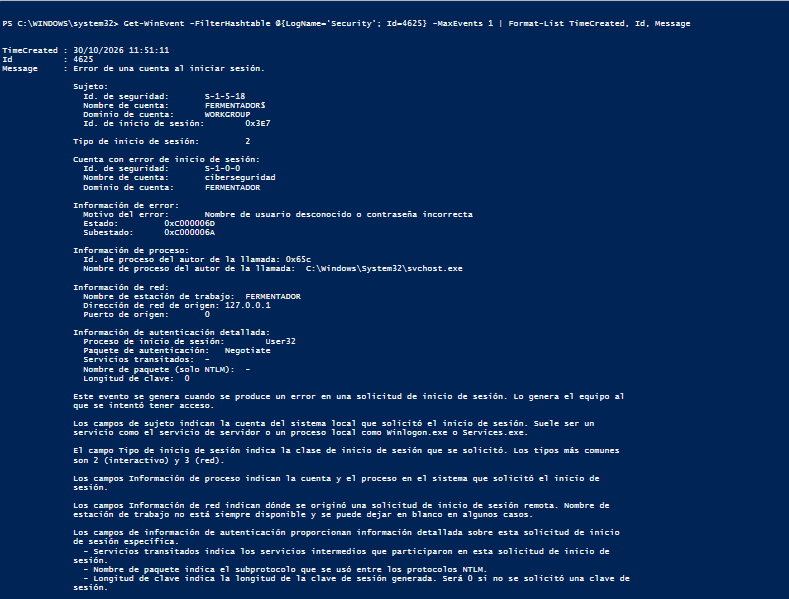
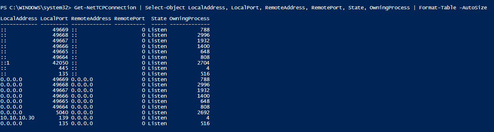

# 02 · Detección y auditoría

## 1. Qué estamos investigando
En el caso del profesor, un empleado abre un adjunto de un correo aparentemente enviado por Recursos Humanos. Después aparecen alertas antivirus, conexiones hacia una IP no habitual, intentos de acceder a recursos compartidos y la posibilidad de que se hayan extraído datos personales de clientes.

**Clasificación provisional del caso:** phishing con posible malware, compromiso de un equipo, posibles accesos no autorizados y posible exfiltración. **Severidad inicial propuesta: alta**, por el riesgo sobre datos personales y sistemas internos; debe revisarse según las evidencias reales y el alcance confirmado.

## 2. Activos implicados
- Equipo del empleado que abrió el adjunto.
- Cuenta e identidad corporativa del usuario.
- Correo electrónico y posible adjunto.
- Recursos compartidos, servidores y servicios de red.
- Información personal de clientes, si se confirma el acceso o la salida de datos.

## 3. Herramientas de detección
He utilizado herramientas integradas en Windows 11: **PowerShell, registro Security, Microsoft Defender, firewall y consultas de conexiones TCP**. Para un entorno empresarial serían pertinentes también la centralización de registros, un EDR y sistemas IDS/IPS o SIEM si la organización dispone de ellos. No se afirma que esas herramientas adicionales estén instaladas en la máquina de prueba.

## 4. Registro de eventos de Windows
```powershell
Get-WinEvent -ListLog Security | Select-Object LogName, IsEnabled, RecordCount, MaximumSizeInBytes
```



Se verificó que el registro estaba habilitado, con **14.327 entradas** en el momento de la consulta.

### Eventos 4624
```powershell
Get-WinEvent -FilterHashtable @{LogName='Security'; Id=4624} -MaxEvents 5 |
    Select-Object TimeCreated, Id, Message
```


Se obtuvieron cinco autenticaciones correctas. Un evento 4624 no implica necesariamente una sesión iniciada manualmente por una persona.

### Eventos 4625
```powershell
Get-WinEvent -FilterHashtable @{LogName='Security'; Id=4625} -MaxEvents 5 |
    Select-Object TimeCreated, Id, Message
```


Aparecieron cuatro eventos de octubre de 2026. Consulté el más reciente:

```powershell
Get-WinEvent -FilterHashtable @{LogName='Security'; Id=4625} -MaxEvents 1 |
    Format-List TimeCreated, Id, Message
```



La cuenta de prueba `ciberseguridad` tenía un fallo de autenticación compatible con contraseña incorrecta (`0xC000006A`), inicio de sesión tipo 2 y dirección local `127.0.0.1`. **No lo relacionamos con un ataque:** ocurrió antes de crear el caso práctico.

## 5. Revisión de conexiones TCP
```powershell
Get-NetTCPConnection |
    Select-Object LocalAddress, LocalPort, RemoteAddress, RemotePort, State, OwningProcess |
    Format-Table -AutoSize
```



Había puertos locales en escucha, incluidos **135, 139, 445 y 5040**, y no se observaron conexiones TCP `Established` en la consulta inicial. El puerto 445 corresponde al servicio SMB, relevante para investigar el acceso a carpetas compartidas; **su mera apertura no demuestra un acceso indebido**.

Identifiqué el proceso y el servicio asociados al puerto 5040:

```powershell
Get-Process -Id 2692 | Select-Object Id, ProcessName, Path
Get-CimInstance Win32_Service | Where-Object {$_.ProcessId -eq 2692} |
    Select-Object Name, DisplayName, State, ProcessId
```

Correspondían a `svchost.exe` y `CDPSvc`, servicio legítimo de la plataforma de dispositivos conectados.

## 6. Comprobación del historial antivirus
```powershell
Get-MpThreatDetection | Select-Object InitialDetectionTime, ThreatID, ActionSuccess, Resources
```

La consulta no devolvió detecciones. Posteriormente se solicitó un análisis personalizado del adjunto inocuo:

```powershell
Start-MpScan -ScanType CustomScan -ScanPath "C:\Laboratorio\Actualizacion_RRHH.txt"
```

La consulta siguiente tampoco devolvió detecciones. Se buscaron eventos **1000** y **1001** en el canal operativo de Defender y no se encontraron registros del día **17/11/2026**; por tanto **no quedó verificada la finalización del análisis en ese canal**. No se presenta como una prueba superada de detección de malware.

## 7. Qué falta por comprobar
Para asociar con fundamento la actividad de red a una exfiltración real harían falta conexiones, destinos, marcas temporales y volúmenes de tráfico coherentes, además de contrastarlos con el incidente. El análisis OSINT de una IP y la captura de tráfico del laboratorio aún no se han realizado.

## Conclusión
La auditoría muestra que se pueden consultar autenticaciones, servicios y puertos con herramientas nativas de Windows. Es una **línea base previa**: no demuestra por sí misma ni phishing ejecutado ni robo de información. La [ficha de incidente](ficha-incidente.md) separa hechos del enunciado, observaciones e hipótesis.
