# 02 · Detección y auditoría

## 1. Qué estamos investigando
En el escenario planteado, un empleado abre un adjunto de un correo aparentemente enviado por Recursos Humanos. Después aparecen alertas antivirus, conexiones hacia una IP no habitual, intentos de acceder a recursos compartidos y la posibilidad de que se hayan extraído datos personales de clientes.

**Clasificación provisional del caso:** phishing con posible malware, compromiso de un equipo, posibles accesos no autorizados y posible exfiltración. **Severidad inicial propuesta: alta**, por el riesgo sobre datos personales y sistemas internos; debe revisarse según las evidencias reales y el alcance confirmado.

## 2. Activos implicados
- Equipo del empleado que abrió el adjunto.
- Cuenta e identidad corporativa del usuario.
- Correo electrónico y posible adjunto.
- Recursos compartidos, servidores y servicios de red.
- Información personal de clientes, si se confirma el acceso o la salida de datos.

## 3. Herramientas de detección
He utilizado herramientas integradas en Windows 11: **PowerShell, registro Security, Microsoft Defender, firewall y consultas de conexiones TCP**. Para un entorno empresarial serían pertinentes también la centralización de registros, un EDR y sistemas IDS/IPS o SIEM si la organización dispone de ellos. No se afirma que esas herramientas adicionales estén instaladas en la máquina de prueba.

## 4. Registro de eventos de Windows
```powershell
Get-WinEvent -ListLog Security | Select-Object LogName, IsEnabled, RecordCount, MaximumSizeInBytes
```


Se verificó que el registro estaba habilitado, con **14.327 entradas** en el momento de la consulta.

### Eventos 4624
```powershell
Get-WinEvent -FilterHashtable @{LogName='Security'; Id=4624} -MaxEvents 5 |
    Select-Object TimeCreated, Id, Message
```

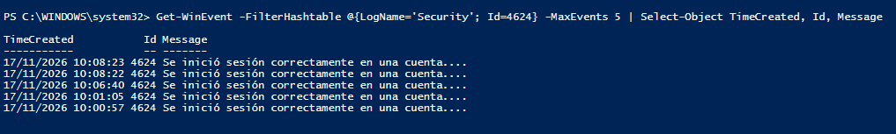

Se obtuvieron cinco autenticaciones correctas. Un evento 4624 no implica necesariamente una sesión iniciada manualmente por una persona.

### Eventos 4625
```powershell
Get-WinEvent -FilterHashtable @{LogName='Security'; Id=4625} -MaxEvents 5 |
    Select-Object TimeCreated, Id, Message
```

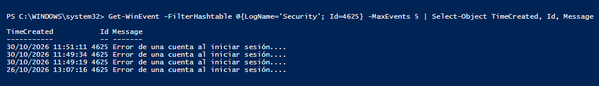

Aparecieron cuatro eventos de octubre de 2026. Consulté el más reciente:

```powershell
Get-WinEvent -FilterHashtable @{LogName='Security'; Id=4625} -MaxEvents 1 |
    Format-List TimeCreated, Id, Message
```


La cuenta de prueba `ciberseguridad` tenía un fallo de autenticación compatible con contraseña incorrecta (`0xC000006A`), inicio de sesión tipo 2 y dirección local `127.0.0.1`. **No lo relacionamos con un ataque:** ocurrió antes de crear el caso práctico.

## 5. Revisión de conexiones TCP
```powershell
Get-NetTCPConnection |
    Select-Object LocalAddress, LocalPort, RemoteAddress, RemotePort, State, OwningProcess |
    Format-Table -AutoSize
```


Había puertos locales en escucha, incluidos **135, 139, 445 y 5040**, y no se observaron conexiones TCP `Established` en la consulta inicial. El puerto 445 corresponde al servicio SMB, relevante para investigar el acceso a carpetas compartidas; **su mera apertura no demuestra un acceso indebido**.

Identifiqué el proceso y el servicio asociados al puerto 5040:

```powershell
Get-Process -Id 2692 | Select-Object Id, ProcessName, Path
Get-CimInstance Win32_Service | Where-Object {$_.ProcessId -eq 2692} |
    Select-Object Name, DisplayName, State, ProcessId
```

Correspondían a `svchost.exe` y `CDPSvc`, servicio legítimo de la plataforma de dispositivos conectados.

## 6. Comprobación del historial antivirus
```powershell
Get-MpThreatDetection | Select-Object InitialDetectionTime, ThreatID, ActionSuccess, Resources
```

La consulta no devolvió detecciones. Posteriormente se solicitó un análisis personalizado del adjunto inocuo:

```powershell
Start-MpScan -ScanType CustomScan -ScanPath "C:\Laboratorio\Actualizacion_RRHH.txt"
```

La consulta siguiente tampoco devolvió detecciones. Se buscaron eventos **1000** y **1001** en el canal operativo de Defender y no se encontraron registros del día **17/11/2026**; por tanto **no quedó verificada la finalización del análisis en ese canal**. No se presenta como una prueba superada de detección de malware.

## 7. Ficha inicial del incidente INC-2026-001

**Caso de clase. No es un incidente real confirmado en el laboratorio.**

| Campo | Registro |
|---|---|
| Identificador | INC-2026-001 |
| Tipo | Phishing; posible ejecución de malware y acceso no autorizado |
| Severidad provisional | **Alta**, pendiente de confirmar impacto y alcance |
| Origen de la alerta | Escenario ficticio de este trabajo |
| Fecha y hora de detección real | No facilitadas en el enunciado |
| Estado | Investigación simulada en desarrollo |
| Responsable de documentación | Analista del laboratorio (rol de la práctica) |

#### 1. Información que aporta el enunciado
- Una empresa ficticia de aproximadamente cien trabajadores recibe un correo aparentemente de Recursos Humanos.
- Un empleado abre un adjunto.
- Se observan alertas de antivirus y conexiones externas sospechosas.
- Se detectan intentos de acceso a carpetas compartidas.
- Existe la posibilidad de que se hayan expuesto datos personales de clientes.

El enunciado describe **sospechas y señales de alerta**. No determina por sí solo qué datos salieron, qué malware actuó ni qué sistemas quedaron comprometidos.

#### 2. Activos que revisar
Equipo del empleado, cuenta corporativa, correo recibido, adjunto, ficheros compartidos, sistema antivirus, registros de autenticación, conexiones de red y repositorios que puedan contener datos personales.

#### 3. Información obtenida en el laboratorio
El 17/11/2026 se comprobaron los registros Security del Windows 11 virtual, los perfiles del firewall, las conexiones TCP y los servicios locales. Los resultados son previos a la creación del correo ficticio:

- Registro Security habilitado; 14.327 entradas en la consulta.
- Cinco eventos 4624 observados.
- Cuatro eventos 4625 anteriores, de octubre; el estudiado reflejaba una contraseña incorrecta con IP `127.0.0.1`. **No se atribuyen al caso de phishing.**
- Puertos 135, 139, 445 y 5040 en escucha. No demuestran un intento de acceso.
- Correo de prueba `COR-001` y adjunto inocuo preparados en `C:\Laboratorio`.
- Copia preservada `EV-001` con comprobación SHA-256 satisfactoria.

#### 4. Hipótesis por verificar
1. El adjunto del escenario pudo iniciar código malicioso.
2. Las conexiones exteriores podrían corresponder a comunicación con infraestructura del atacante.
3. Los accesos a carpetas compartidas podrían indicar reconocimiento o movimiento lateral.
4. La salida de información podría afectar datos personales.

Ninguna de estas cuatro hipótesis se ha probado mediante la simulación educativa realizada.

#### 5. Medidas recomendadas para el escenario
Preservar las evidencias antes de alterarlas, valorar el aislamiento del equipo, revisar los registros y conexiones, identificar las cuentas afectadas, coordinar la respuesta con sistemas y privacidad y preparar las comunicaciones que procedan. Las medidas efectivamente ejecutadas en el laboratorio se añadirán al realizar el apartado 4.

#### 6. Evidencias documentadas
- [Auditoría inicial de Windows](../laboratorio/practica-00.md).
- [Investigación: análisis del correo](../03-investigacion/README.md#2-análisis-del-correo-y-adjunto-simulados).
- [Investigación: SHA-256](../03-investigacion/README.md#3-integridad-del-adjunto-sha-256).
- [Investigación: cadena de custodia](../03-investigacion/README.md#4-cadena-de-custodia-de-la-copia-ev-001).

**Pendiente:** IP sospechosa concreta, cronología completa, alcance de los datos, correlación de eventos y decisiones de contención ejecutadas.

## 8. Puertos, procesos y firma digital (capturas 20–24)

Esta ampliación se realizó en Windows 11 con PowerShell para observar el tráfico TCP del equipo, identificar un puerto de escucha y verificar el ejecutable asociado. **No se utilizó malware y no se ha identificado una conexión con el incidente ficticio.** Los identificadores de proceso y el estado de las conexiones son temporales; lo que aparece corresponde al momento de cada consulta.

### 8.1. Conexiones TCP establecidas — captura 20

```powershell
Get-NetTCPConnection -State Established -ErrorAction SilentlyContinue |
    Select-Object LocalAddress, LocalPort, RemoteAddress, RemotePort, State, OwningProcess |
    Format-Table -AutoSize
```

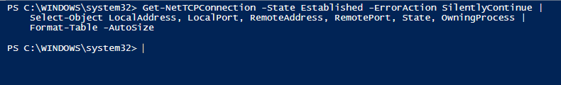

La consulta **no devolvió filas**. Significa que no se observaron conexiones TCP en estado `Established` en ese instante, no que la máquina carezca de conexión a Internet ni que esté libre de amenazas.

### 8.2. Puertos TCP en escucha — captura 21

```powershell
Get-NetTCPConnection -State Listen |
    Select-Object LocalAddress, LocalPort, State, OwningProcess |
    Sort-Object LocalPort |
    Format-Table -AutoSize
```

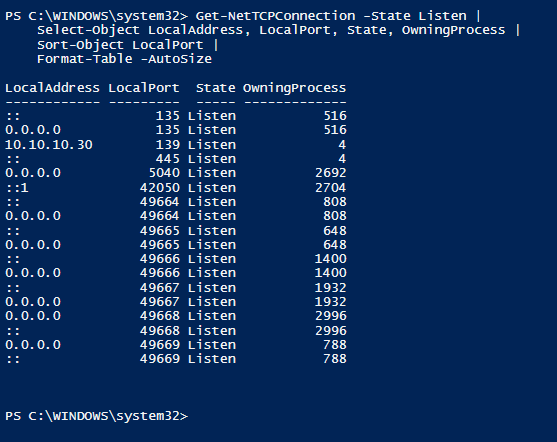

Se observaron, entre otros, **135** (RPC), **139** (servicios NetBIOS), **445** (SMB), **5040** y **42050**, además de puertos altos del sistema. En la misma auditoría, el puerto 5040 se había relacionado con `CDPSvc`.

El puerto **445** es relevante para el contexto del escenario porque se mencionan carpetas compartidas, pero un puerto en escucha no demuestra acceso indebido. El puerto **42050** llamó la atención para comprobar su proceso propietario.

### 8.3. Relación entre puerto 42050 y PID 2704 — captura 22

```powershell
Get-NetTCPConnection -State Listen -LocalPort 42050 |
    Select-Object LocalAddress, LocalPort, OwningProcess

Get-Process -Id 2704 |
    Select-Object Id, ProcessName, Path
```

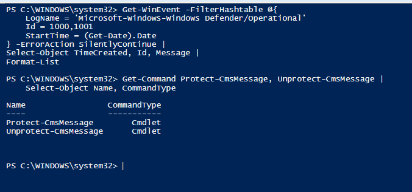

El resultado vinculó **`::1:42050`** con el PID **2704**, pero el segundo comando no mostró el proceso en aquella salida. `::1` es la dirección de bucle local IPv6: esa escucha estaba limitada al propio equipo, no expuesta directamente a la red.

### 8.4. Identificación del proceso y servicio — captura 23

```powershell
Get-Process -Id 2704 -ErrorAction SilentlyContinue |
    Select-Object Id, ProcessName, Path

Get-CimInstance Win32_Service |
    Where-Object { $_.ProcessId -eq 2704 } |
    Select-Object Name, DisplayName, State, ProcessId
```

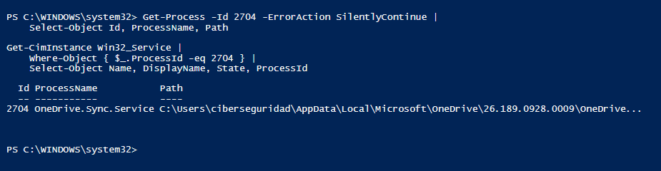

La nueva comprobación permitió identificar el proceso **`OneDrive.Sync.Service`**, con una ruta dentro de `C:\Users\ciberseguridad\AppData\Local\Microsoft\OneDrive\...`. No apareció una fila adicional de servicio de Windows en la consulta realizada; por tanto, **se identificó el proceso, no un servicio registrado mediante esa consulta**.

### 8.5. Verificación de la firma digital — captura 24

```powershell
$proceso = Get-Process -Id 2704 -ErrorAction SilentlyContinue

if ($proceso -and $proceso.Path) {
    Get-AuthenticodeSignature -FilePath $proceso.Path |
        Select-Object Status, @{Name="Firmante";Expression={$_.SignerCertificate.Subject}}
}
```

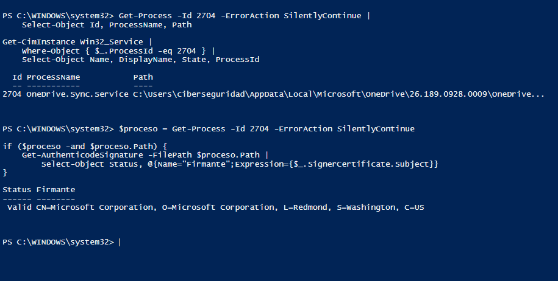

La firma del ejecutable mostró el estado **`Valid`** y el firmante **`Microsoft Corporation`**. Junto con la ruta observada y la escucha en `::1`, el conjunto es **compatible con un componente legítimo de OneDrive**. Una firma digital válida respalda la autenticidad e integridad del binario verificado, pero no garantiza que todo comportamiento de ese proceso o de su entorno sea seguro.

### 8.6. Conclusión técnica de esta ampliación

El análisis permitió seguir una secuencia útil de auditoría: **puerto → PID → proceso → ruta → firma digital**. No se encontró una conexión exterior sospechosa ni evidencias que relacionen el puerto 42050 con el phishing del escenario. El resultado se documenta como una comprobación real de un componente del equipo, sin atribuirle actividad maliciosa.

## 9. Recursos compartidos SMB (capturas 25–27)

### 9.1. Recursos compartidos configurados — captura 25

```powershell
Get-SmbShare |
    Select-Object Name, Path, Description |
    Format-Table -AutoSize
```

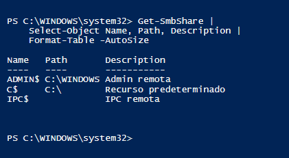

El resultado mostró los recursos administrativos habituales **`ADMIN$`** (ruta `C:\WINDOWS`), **`C$`** (ruta `C:\`) e **`IPC$`** (para comunicación entre procesos). No se observaron recursos compartidos adicionales en ese momento. Su presencia no demuestra accesos indebidos ni permite reconstruir sesiones anteriores.

### 9.2. Sesiones SMB activas — captura 26

```powershell
Get-SmbSession |
    Select-Object ClientComputerName, ClientUserName, NumOpens, SecondsExists |
    Format-Table -AutoSize
```

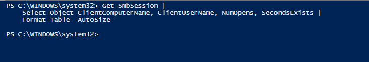

La consulta no devolvió filas. **No se observaron sesiones SMB activas en ese instante.** Este comando no recupera sesiones que ya finalizaron.

### 9.3. Archivos abiertos mediante SMB — captura 27

```powershell
Get-SmbOpenFile |
    Select-Object ClientComputerName, ClientUserName, Path |
    Format-Table -AutoSize
```

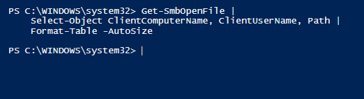

Tampoco aparecieron resultados. Por tanto, **no se observaron archivos abiertos por clientes SMB** en ese momento.

### 9.4. Valoración técnica

Las consultas 25–27 aportan una imagen del estado actual del servicio de archivos: recursos administrativos presentes, sin sesiones ni archivos SMB abiertos observados. **No prueban ni descartan accesos históricos**, y no permiten concluir que los intentos de acceso a compartidos descritos en el escenario hayan ocurrido en nuestra máquina virtual. Para reconstruir accesos pasados harían falta eventos y registros adecuados de los equipos y servidores afectados, además de correlacionar usuarios y tiempos.

## 10. Auditoría de recursos compartidos (capturas 28–29)

Tras comprobar que en el momento de la consulta no había sesiones ni archivos SMB abiertos, revisé si Windows estaba configurado para conservar registros de accesos a recursos compartidos. La comprobación se efectuó **sin cambiar las políticas de auditoría**.

### 10.1. Estado de las subcategorías de auditoría — captura 28

Se intentó consultar la categoría mediante `auditpol /get /category:"Acceso a objetos"`, pero el sistema devolvió el error **0x00000057 (parámetro incorrecto)**. Para consultar la configuración real utilicé:

```powershell
auditpol /get /category:*
```

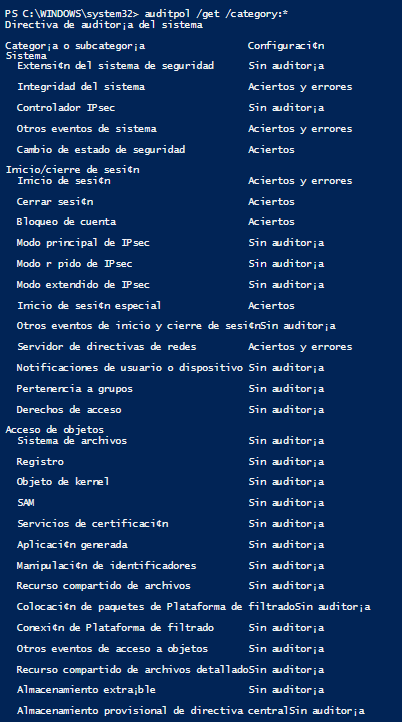

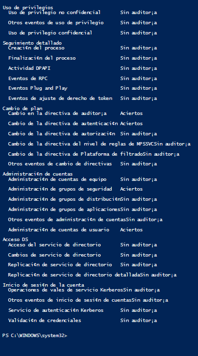

Dentro de **Acceso a objetos**, las subcategorías **Sistema de archivos**, **Recurso compartido de archivos** y **Recurso compartido de archivos detallado** figuraban como `Sin auditoría`. Esto supone una limitación para reconstruir determinados accesos a recursos compartidos utilizando esos eventos.

### 10.2. Consulta de eventos de acceso — captura 29

```powershell
Get-WinEvent -FilterHashtable @{
    LogName = 'Security'
    Id = 5140,5145
} -MaxEvents 10 -ErrorAction SilentlyContinue |
    Select-Object TimeCreated, Id, Message |
    Format-List
```

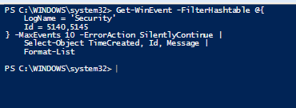

La consulta no mostró eventos de los tipos **5140** (acceso a recurso compartido de red) ni **5145** (comprobación detallada de acceso). Dado que la auditoría correspondiente está desactivada, **la ausencia de estos eventos no demuestra que nunca hayan ocurrido accesos**. Solo indica que no se encontraron registros de esos identificadores en la consulta realizada.

### 10.3. Conclusión de la comprobación SMB

El sistema tiene recursos administrativos compartidos, pero en las consultas no se observaron sesiones, archivos abiertos ni eventos de auditoría SMB 5140/5145. No se puede atribuir un acceso indebido al escenario ficticio con esos resultados. Para investigar accesos pasados en un entorno real haría falta disponer de auditoría pertinente habilitada con anterioridad y correlacionar eventos de clientes y servidores.

## 11. OSINT, monitorización y análisis de tráfico

### 11.1. Investigación en fuentes abiertas (OSINT)

OSINT consiste en recopilar, contrastar y documentar información disponible legítimamente en fuentes públicas. En un incidente de phishing permitiría investigar una dirección IP remota, un dominio del remitente o indicadores facilitados por el antivirus, una vez que se disponga de ellos.

Siguiendo el método de los apuntes de auditoría, el proceso sería: **definir qué se busca → seleccionar las fuentes → recopilar → validar → correlacionar → analizar → documentar**. Ante un dominio sospechoso se podrían revisar sus registros DNS públicos, certificados, avisos oficiales e informes técnicos, anotando siempre la fuente, fecha y fiabilidad.

**Aplicación real a nuestro caso:** el enunciado menciona una IP inusual, pero **no proporciona su valor**. Nuestra auditoría tampoco encontró una conexión externa concreta que podamos atribuir al incidente. El dominio `.invalid` del mensaje creado en el laboratorio es deliberadamente ficticio y no debe analizarse como si fuera un dominio real de un atacante. Por ello, no se ha realizado una consulta OSINT de un indicador del caso ni se afirma haber encontrado reputación maliciosa.

Tampoco debe confundirse reputación con prueba: que una IP aparezca en una lista de amenazas no demostraría por sí solo su participación en este incidente.

### 11.2. Análisis de tráfico y herramientas de monitorización

En el material docente se distinguen **logs**, **SIEM** (centralización y correlación), **IDS/IPS** (detección y, en IPS, posible bloqueo), **EDR** (actividad del equipo), **NDR** (visibilidad de red) y **SOAR** (automatización de procedimientos). Son herramientas que podrían utilizarse según los recursos de la empresa; **no están desplegadas ni verificadas en este laboratorio**.

En Windows consultamos las conexiones TCP y los procesos propietarios. Es una observación puntual, **no una captura de paquetes ni una prueba del contenido de las comunicaciones**. Para investigar la supuesta exfiltración haría falta correlacionar destinos, procesos, marcas temporales, registros DNS y volúmenes de transferencia; en caso justificado, obtener una captura de tráfico autorizada.

**Conclusión:** no hay tráfico externo malicioso confirmado que pueda presentarse como hallazgo de la práctica. No añadimos capturas artificiales ni se necesita instalar una herramienta nueva solo para ilustrar el concepto.

### 11.3. Limitaciones y mejoras de auditoría

La consulta de `auditpol` mostró que la auditoría de acceso a recursos compartidos estaba deshabilitada. Por ello, la ausencia de eventos 5140 y 5145 no permite reconstruir accesos antiguos. En una empresa convendría definir previamente qué registros conservar, limitar su acceso, sincronizar los relojes y comprobar periódicamente las políticas de auditoría.

Las conclusiones de este capítulo se basan en las capturas reales y no en una supuesta infección del sistema de laboratorio.

**Temario utilizado:** «2. Auditoría de incidentes de ciberseguridad»: taxonomía, controles de detección, investigación en fuentes abiertas, clasificación, valoración, documentación y seguimiento inicial.

## 12. Limitaciones y comprobaciones no efectuadas
Para asociar con fundamento la actividad de red a una exfiltración real harían falta conexiones, destinos, marcas temporales y volúmenes de tráfico coherentes, además de contrastarlos con el incidente. El análisis OSINT de una IP y la captura de tráfico del laboratorio aún no se han realizado.


---

## 13. Conclusión del apartado
La auditoría permitió comprobar autenticaciones, procesos, puertos, firmas digitales y configuración de auditoría de los recursos compartidos. He preparado también la ficha de clasificación y severidad provisional INC-2026-001. En conjunto, los resultados constituyen una **línea base del laboratorio** y no demuestran por sí solos una infección ni una fuga de información. La ausencia de un indicador externo verificable limita la aplicación práctica de OSINT y el análisis retrospectivo del tráfico; estas limitaciones quedan documentadas en lugar de inventar hallazgos.

