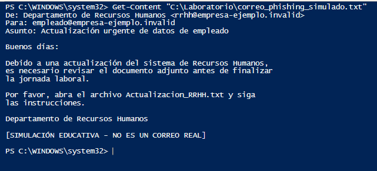
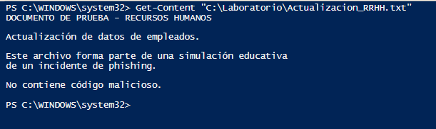
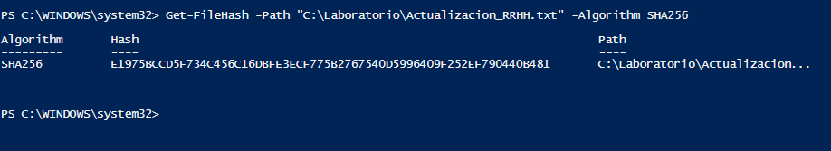
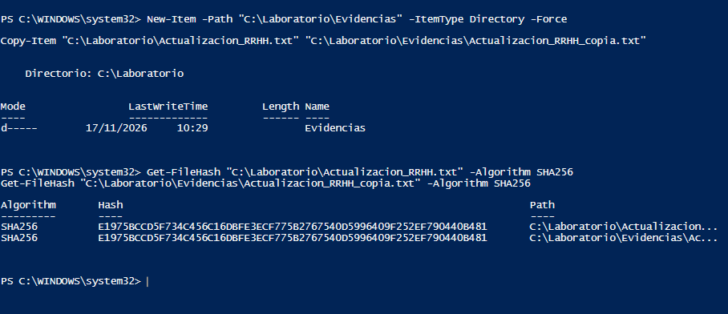
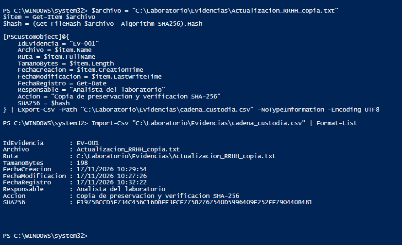

# 03 · Investigación de incidentes y preservación de evidencias

## 1. Alcance y forma de trabajo

### Objetivo
Reunir y analizar evidencias sin confundir la simulación del laboratorio con un incidente real. El caso del profesor plantea un correo de phishing, un adjunto potencialmente malicioso, conexiones externas sospechosas y posible exfiltración.

En este capítulo se presentan seguidas las prácticas que se realizaron realmente en Windows 11: correo simulado, integridad SHA-256 y cadena de custodia. **El adjunto es texto inocuo y no se ha generado ninguna infección.**

## 2. Análisis del correo y adjunto simulados

### Contexto
Para reproducir con seguridad el escenario del profesor, creé un mensaje ficticio que aparenta proceder del departamento de Recursos Humanos. No se envió ningún correo ni se abrió un adjunto malicioso: se trabajó con dos archivos de texto dentro de `C:\Laboratorio`.

#### 1. Preparación del mensaje
En PowerShell creé `correo_phishing_simulado.txt` con los siguientes datos: remitente aparente `rrhh@empresa-ejemplo.invalid`, destinatario `empleado@empresa-ejemplo.invalid`, asunto «Actualización urgente de datos de empleado» y una petición de abrir `Actualizacion_RRHH.txt`.

El dominio `.invalid` se utiliza para documentación y no corresponde a un buzón real.

Para comprobar el archivo:

```powershell
Get-Content "C:\Laboratorio\correo_phishing_simulado.txt"
```



El mensaje utiliza una supuesta autoridad (Recursos Humanos) y urgencia para motivar la apertura del adjunto. **No se demuestra una falsificación técnica del remitente**, ya que es un archivo de texto y no tenemos cabeceras SMTP, registros SPF, DKIM o DMARC de un mensaje recibido.

#### 2. Adjunto ficticio
Creé `Actualizacion_RRHH.txt` con un texto que indica expresamente que se trata de un ejercicio educativo sin código malicioso. Para mostrarlo:

```powershell
Get-Content "C:\Laboratorio\Actualizacion_RRHH.txt"
```



Este archivo permite practicar los pasos de preservación y verificación sin riesgo de ejecutar una carga maliciosa.

#### 3. Identificación de indicadores
```powershell
Select-String -Path "C:\Laboratorio\correo_phishing_simulado.txt" -Pattern "De:","Asunto:","urgente","Actualizacion_RRHH"
```

El comando localizó el remitente aparente, el asunto urgente y la referencia al adjunto. Los indicadores de ingeniería social son **contextuales**; una palabra como «urgente» no prueba un ataque por sí misma.

#### 4. Metadatos
```powershell
Get-Item "C:\Laboratorio\correo_phishing_simulado.txt" |
    Select-Object Name, Length, CreationTime, LastWriteTime
```

Se obtuvieron **480 bytes** y fechas de creación y modificación **17/11/2026 10:25:28**. Corresponden al archivo generado en el laboratorio, no a una fecha de envío.

#### 5. Ficha de análisis
Guardé una ficha con identificador `COR-001` y las rutas del mensaje, el adjunto y la copia preservada.

```powershell
Get-Content "C:\Laboratorio\Evidencias\ficha_analisis_correo.txt"
```


### Conclusión
La simulación permite identificar señales de ingeniería social y practicar la documentación de evidencias. No aporta cabeceras de correo reales, comportamiento de malware ni prueba de exfiltración. La integridad del adjunto se documenta en [SHA-256](practica-hash.md).

## 3. Integridad del adjunto: SHA-256

### Objetivo
Calcular la huella SHA-256 del archivo adjunto ficticio y comprobar si una copia conserva exactamente el mismo contenido. Es una práctica de preservación de evidencias aplicable a la investigación del incidente.

**Entorno:** Windows 11, PowerShell, archivo de texto inocuo `C:\Laboratorio\Actualizacion_RRHH.txt`. Fecha: 17/11/2026.

#### 1. Hash del adjunto
```powershell
Get-FileHash -Path "C:\Laboratorio\Actualizacion_RRHH.txt" -Algorithm SHA256
```



**Hash obtenido:**

```text
E1975BCCD5F734C456C16DBFE3ECF775B2767540D5996409F252EF790440B481
```

Este hash identifica los bytes del archivo en el momento de la consulta. No sirve para cifrar el contenido ni para demostrar que es seguro.

#### 2. Copia de preservación
```powershell
New-Item -Path "C:\Laboratorio\Evidencias" -ItemType Directory -Force
Copy-Item "C:\Laboratorio\Actualizacion_RRHH.txt" "C:\Laboratorio\Evidencias\Actualizacion_RRHH_copia.txt"
```

Tras copiarlo, calculé ambos hashes:

```powershell
Get-FileHash "C:\Laboratorio\Actualizacion_RRHH.txt" -Algorithm SHA256
Get-FileHash "C:\Laboratorio\Evidencias\Actualizacion_RRHH_copia.txt" -Algorithm SHA256
```



**Resultado:** los dos valores SHA-256 coincidían. La copia era idéntica en contenido al original en el momento de la comparación.

#### 3. Metadatos de la copia
```powershell
Get-Item "C:\Laboratorio\Evidencias\Actualizacion_RRHH_copia.txt" |
    Select-Object Name, FullName, Length, CreationTime, LastWriteTime
```

Se observaron **198 bytes**, fecha de creación de la copia **17/11/2026 10:29:54** y última modificación **17/11/2026 10:27:26**. La copia puede heredar la fecha de modificación del original mientras recibe una nueva fecha de creación.

### Conclusión
La comparación SHA-256 respalda que no hubo cambios en el contenido entre el original y la copia verificada. Es una comprobación de integridad reproducible, pero **no acredita por sí sola el origen, la autenticidad ni toda la cadena de custodia**. El registro de movimientos se trata en [la práctica de custodia](practica-custodia.md).

## 4. Cadena de custodia de la copia EV-001

### Objetivo
Dejar constancia de qué archivo se preservó, dónde se guardó, cuándo se registró y qué comprobación de integridad se realizó. El ejercicio reproduce **un registro inicial educativo**, no una cadena de custodia judicial completa.

### Evidencia
- **Identificador:** EV-001.
- **Archivo:** `Actualizacion_RRHH_copia.txt`.
- **Origen:** copia de `C:\Laboratorio\Actualizacion_RRHH.txt`.
- **Ruta de preservación:** `C:\Laboratorio\Evidencias\Actualizacion_RRHH_copia.txt`.
- **Tamaño:** 198 bytes.
- **Creación de la copia:** 17/11/2026 10:29:54.
- **Última modificación del contenido:** 17/11/2026 10:27:26.
- **Registro:** 17/11/2026 10:32:22.
- **Responsable indicado:** Analista del laboratorio (rol ficticio).
- **Operación:** copia y verificación SHA-256.

La huella de la copia coincidió con el archivo original:

```text
E1975BCCD5F734C456C16DBFE3ECF775B2767540D5996409F252EF790440B481
```

### Procedimiento
La evidencia se copió antes de consultar sus metadatos:

```powershell
Copy-Item "C:\Laboratorio\Actualizacion_RRHH.txt" "C:\Laboratorio\Evidencias\Actualizacion_RRHH_copia.txt"

Get-Item "C:\Laboratorio\Evidencias\Actualizacion_RRHH_copia.txt" |
    Select-Object Name, FullName, Length, CreationTime, LastWriteTime
```

Después se creó un registro con los datos del archivo y su SHA-256:

```powershell
$archivo = "C:\Laboratorio\Evidencias\Actualizacion_RRHH_copia.txt"
$item = Get-Item $archivo
$hash = (Get-FileHash $archivo -Algorithm SHA256).Hash

[PSCustomObject]@{
    IdEvidencia = "EV-001"
    Archivo = $item.Name
    Ruta = $item.FullName
    TamanoBytes = $item.Length
    FechaCreacion = $item.CreationTime
    FechaModificacion = $item.LastWriteTime
    FechaRegistro = Get-Date
    Responsable = "Analista del laboratorio"
    Accion = "Copia de preservacion y verificacion SHA-256"
    SHA256 = $hash
} | Export-Csv -Path "C:\Laboratorio\Evidencias\cadena_custodia.csv" -NoTypeInformation -Encoding UTF8
```

Finalmente se leyó el CSV:

```powershell
Import-Csv "C:\Laboratorio\Evidencias\cadena_custodia.csv" | Format-List
```



### Observaciones y límites
El registro identifica la copia preservada, pero no documenta todas las personas que pudieran acceder posteriormente ni permite certificar la hora mediante una fuente externa. Para un caso real también serían necesarios controles de acceso, almacenamiento protegido y anotación de cada transferencia o actuación posterior.

### Conclusión
Se generó un primer registro rastreable para la evidencia EV-001. Junto a los dos hashes coincidentes, permite explicar la importancia de la integridad y la trazabilidad durante una investigación, sin atribuirle garantías que una simulación no tiene.

## 5. Cronología de trabajo (no cronología del ataque)

| Fecha / hora | Actuación en el laboratorio |
|---|---|
| Octubre de 2026 | Eventos 4625 previos y no relacionados con el escenario |
| 17/11/2026, auditoría inicial | Consulta de estado del sistema, eventos, firewall, antivirus y puertos |
| 17/11/2026 10:25:28 | Creación/modificación del mensaje simulado de 480 bytes |
| 17/11/2026 10:27:26 | Última modificación del adjunto inocuo de 198 bytes |
| 17/11/2026 10:29:54 | Creación de la copia de preservación |
| 17/11/2026 10:32:22 | Registro de custodia EV-001 |

La hora real del phishing del enunciado no se ha facilitado. No se debe convertir la cronología del laboratorio en una reconstrucción falsa del ataque.

## 6. Otras evidencias necesarias en una investigación real

Sería necesario recoger, con autorización, el mensaje original con sus cabeceras, alertas antivirus, eventos relacionados en el tiempo, lista de procesos y servicios, conexiones y destinos externos, DNS, registros de los recursos compartidos y, según las circunstancias, una adquisición forense del equipo. Cada evidencia debería tener origen, responsable, fechas, ubicación, huella y registro de transferencias.

## 7. Conclusiones y limitaciones

Se documentó el correo ficticio COR-001 y la copia EV-001; la coincidencia SHA-256 demuestra integridad del contenido comparado, pero no demuestra malware, acceso indebido ni exfiltración. Tampoco hay pruebas de movimiento lateral por el mero hecho de observar SMB en escucha. Las actividades de adquisición más amplia, tráfico y OSINT siguen pendientes.

**Fuentes:** [material docente](https://www.jesusninoc.com/09/30/incidentes-de-ciberseguridad/) y [bibliografía](../FUENTES.md).
