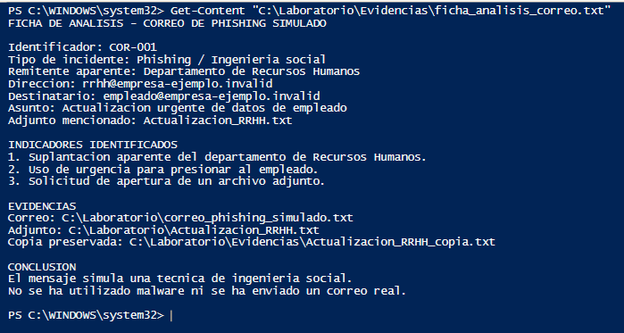
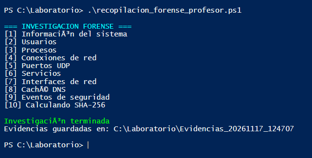
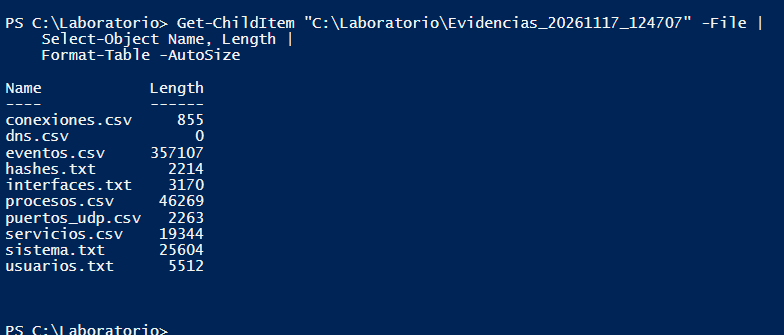
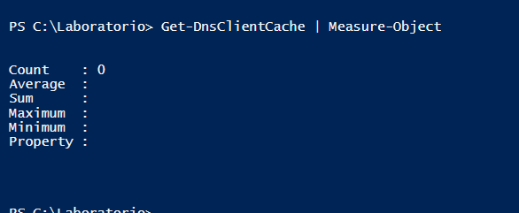

# 03 · Investigación y preservación de evidencias

Este capítulo sigue **las seis tareas del enunciado, en el mismo orden**, y conserva las prácticas y capturas realizadas. El correo y el adjunto del laboratorio son textos inocuos. Los sucesos descritos en el escenario no se presentan como actividad maliciosa verificada en la máquina virtual.

## 1. Identificar las evidencias necesarias para investigar el incidente

El enunciado plantea un correo aparentemente enviado por Recursos Humanos, la apertura de un adjunto, alertas antivirus, conexiones sospechosas y la posibilidad de accesos indebidos a archivos y datos personales. Son **hechos del supuesto, no incidentes comprobados en nuestra máquina virtual**.

| Evidencia que buscaría | Finalidad | Situación en nuestro laboratorio |
|---|---|---|
| Correo original con cabeceras completas y adjunto | Determinar el remitente técnico, ruta de entrega y características del archivo | Solo se generó un mensaje de texto simulado COR-001 y un adjunto inocuo |
| Alertas de Microsoft Defender/EDR | Conocer nombres de detección, horarios y actuaciones | Se consultó la configuración de Defender en el apartado 2, sin detección atribuible al caso |
| Eventos de Windows y autenticaciones | Reconstruir cuentas, intentos de acceso y tiempo del incidente | Hay capturas del registro Security; los 4625 antiguos no se atribuyen al ataque |
| Procesos, servicios y persistencia | Buscar ejecución anómala o modificaciones | Se consultaron procesos y servicios y se ejecutó un script de recopilación |
| Conexiones, DNS y registros de red | Identificar destinos y posibles transferencias | Se observaron conexiones TCP y SMB; **no** se confirmó tráfico malicioso |
| Accesos a compartidos y repositorios de clientes | Comprobar acceso indebido o exfiltración | En nuestra VM no se encontraron sesiones SMB activas; auditoría SMB desactivada |
| Archivo original, copias, metadatos y hashes | Conservar elementos examinables y verificar su integridad | Se preservó EV-001 con SHA-256 y registro inicial de custodia |

En una investigación real recogería las fuentes autorizadas priorizando la información volátil y conservando quién, cómo, cuándo y dónde obtiene cada evidencia. Las consultas del laboratorio y su alcance aparecen también en el [apartado 2](../02-deteccion-auditoria/README.md).

## 2. Explicar cómo preservar la integridad de las evidencias

Para no modificar innecesariamente los originales, primero documentaría su ubicación, origen, propietario y fechas; obtendría una copia controlada cuando proceda, registraría el responsable de la recogida y calcularía un hash criptográfico de cada fichero relevante.

En la práctica se copió el adjunto inocuo `C:\Laboratorio\Actualizacion_RRHH.txt` a `C:\Laboratorio\Evidencias\Actualizacion_RRHH_copia.txt`. Calculamos SHA-256 del original y de la copia y **coincidieron**; la demostración detallada y las evidencias gráficas están en el [punto 6](#6-calcular-el-hash-sha-256-y-explicar-su-utilidad). El registro de identificación y custodia figura en el [punto 5](#5-documentar-la-cadena-de-custodia).

La integridad no se obtiene solo por calcular una huella: también se requieren almacenamiento protegido, controles de acceso, fechas fiables, trazabilidad de transferencias y un procedimiento para no alterar los originales. En esta práctica educativa solo se verificó el contenido comparado del archivo de prueba, no se certificó una adquisición forense judicial.

## 3. Investigar el correo electrónico y el archivo sospechoso

### Contexto
Para reproducir con seguridad el escenario, creé un mensaje ficticio que aparenta proceder del departamento de Recursos Humanos. No se envió ningún correo ni se abrió un adjunto malicioso: se trabajó con dos archivos de texto dentro de `C:\Laboratorio`.

#### 1. Preparación del mensaje
En PowerShell creé `correo_phishing_simulado.txt` con los siguientes datos: remitente aparente `rrhh@empresa-ejemplo.invalid`, destinatario `empleado@empresa-ejemplo.invalid`, asunto «Actualización urgente de datos de empleado» y una petición de abrir `Actualizacion_RRHH.txt`.

El dominio `.invalid` se utiliza para documentación y no corresponde a un buzón real.

Para comprobar el archivo:

```powershell
Get-Content "C:\Laboratorio\correo_phishing_simulado.txt"
```


El mensaje utiliza una supuesta autoridad (Recursos Humanos) y urgencia para motivar la apertura del adjunto. **No se demuestra una falsificación técnica del remitente**, ya que es un archivo de texto y no tenemos cabeceras SMTP, registros SPF, DKIM o DMARC de un mensaje recibido.

#### 2. Adjunto ficticio
Creé `Actualizacion_RRHH.txt` con un texto que indica expresamente que se trata de un ejercicio educativo sin código malicioso. Para mostrarlo:

```powershell
Get-Content "C:\Laboratorio\Actualizacion_RRHH.txt"
```


Este archivo permite practicar los pasos de preservación y verificación sin riesgo de ejecutar una carga maliciosa.

#### 3. Identificación de indicadores
```powershell
Select-String -Path "C:\Laboratorio\correo_phishing_simulado.txt" -Pattern "De:","Asunto:","urgente","Actualizacion_RRHH"
```

El comando localizó el remitente aparente, el asunto urgente y la referencia al adjunto. Los indicadores de ingeniería social son **contextuales**; una palabra como «urgente» no prueba un ataque por sí misma.

#### 4. Metadatos
```powershell
Get-Item "C:\Laboratorio\correo_phishing_simulado.txt" |
    Select-Object Name, Length, CreationTime, LastWriteTime
```

Se obtuvieron **480 bytes** y fechas de creación y modificación **17/11/2026 10:25:28**. Corresponden al archivo generado en el laboratorio, no a una fecha de envío.

#### 5. Ficha de análisis
Guardé una ficha con identificador `COR-001` y las rutas del mensaje, el adjunto y la copia preservada.

```powershell
Get-Content "C:\Laboratorio\Evidencias\ficha_analisis_correo.txt"
```



### Conclusión
La simulación permite identificar señales de ingeniería social y practicar la documentación de evidencias. No aporta cabeceras de correo reales, comportamiento de malware ni prueba de exfiltración. La integridad del adjunto se documenta en [verificación SHA-256](#6-calcular-el-hash-sha-256-y-explicar-su-utilidad).

## 4. Analizar las conexiones sospechosas

En el escenario se mencionan conexiones hacia una IP poco habitual y la posibilidad de que se hayan enviado datos al exterior. **No se proporciona esa dirección IP ni un registro real de exfiltración.** Por eso no puede comprobarse aquí la reputación de ese destino ni atribuirle una transferencia concreta.

Para investigar estas señales revisaría origen y destino, puertos, protocolo, hora, proceso propietario, consultas DNS y volumen de datos; después correlacionaría las conexiones con las alertas y los registros de usuarios y servidores.

En nuestro laboratorio se ejecutaron `Get-NetTCPConnection`, consultas de puertos en escucha, comprobaciones del proceso `OneDrive.Sync.Service` y sesiones SMB, además de una recopilación automatizada. Esas pruebas están documentadas con sus capturas en el [apartado 2](../02-deteccion-auditoria/README.md) y en el anexo de este capítulo.

**Resultado real:** no se observó una conexión exterior sospechosa atribuible al phishing ni se obtuvo captura de paquetes que permita demostrar exfiltración. Que exista un puerto en escucha o un servicio de Microsoft no demuestra actividad maliciosa. La ausencia de eventos SMB 5140/5145 tampoco descarta accesos pasados, porque las subcategorías de auditoría aparecían deshabilitadas.

## 5. Documentar la cadena de custodia

### Objetivo
Dejar constancia de qué archivo se preservó, dónde se guardó, cuándo se registró y qué comprobación de integridad se realizó. El ejercicio reproduce **un registro inicial educativo**, no una cadena de custodia judicial completa.

### Evidencia
- **Identificador:** EV-001.
- **Archivo:** `Actualizacion_RRHH_copia.txt`.
- **Origen:** copia de `C:\Laboratorio\Actualizacion_RRHH.txt`.
- **Ruta de preservación:** `C:\Laboratorio\Evidencias\Actualizacion_RRHH_copia.txt`.
- **Tamaño:** 198 bytes.
- **Creación de la copia:** 17/11/2026 10:29:54.
- **Última modificación del contenido:** 17/11/2026 10:27:26.
- **Registro:** 17/11/2026 10:32:22.
- **Responsable indicado:** Analista del laboratorio (rol ficticio).
- **Operación:** copia y verificación SHA-256.

La huella de la copia coincidió con el archivo original:

```text
E1975BCCD5F734C456C16DBFE3ECF775B2767540D5996409F252EF790440B481
```

### Procedimiento
La evidencia se copió antes de consultar sus metadatos:

```powershell
Copy-Item "C:\Laboratorio\Actualizacion_RRHH.txt" "C:\Laboratorio\Evidencias\Actualizacion_RRHH_copia.txt"

Get-Item "C:\Laboratorio\Evidencias\Actualizacion_RRHH_copia.txt" |
    Select-Object Name, FullName, Length, CreationTime, LastWriteTime
```

Después se creó un registro con los datos del archivo y su SHA-256:

```powershell
$archivo = "C:\Laboratorio\Evidencias\Actualizacion_RRHH_copia.txt"
$item = Get-Item $archivo
$hash = (Get-FileHash $archivo -Algorithm SHA256).Hash

[PSCustomObject]@{
    IdEvidencia = "EV-001"
    Archivo = $item.Name
    Ruta = $item.FullName
    TamanoBytes = $item.Length
    FechaCreacion = $item.CreationTime
    FechaModificacion = $item.LastWriteTime
    FechaRegistro = Get-Date
    Responsable = "Analista del laboratorio"
    Accion = "Copia de preservacion y verificacion SHA-256"
    SHA256 = $hash
} | Export-Csv -Path "C:\Laboratorio\Evidencias\cadena_custodia.csv" -NoTypeInformation -Encoding UTF8
```

Finalmente se leyó el CSV:

```powershell
Import-Csv "C:\Laboratorio\Evidencias\cadena_custodia.csv" | Format-List
```


### Observaciones y límites
El registro identifica la copia preservada, pero no documenta todas las personas que pudieran acceder posteriormente ni permite certificar la hora mediante una fuente externa. Para un caso real también serían necesarios controles de acceso, almacenamiento protegido y anotación de cada transferencia o actuación posterior.

### Conclusión
Se generó un primer registro rastreable para la evidencia EV-001. Junto a los dos hashes coincidentes, permite explicar la importancia de la integridad y la trazabilidad durante una investigación, sin atribuirle garantías que una simulación no tiene.

## 6. Calcular el hash SHA-256 y explicar su utilidad

### Objetivo
Calcular la huella SHA-256 del archivo adjunto ficticio y comprobar si una copia conserva exactamente el mismo contenido. Es una práctica de preservación de evidencias aplicable a la investigación del incidente.

**Entorno:** Windows 11, PowerShell, archivo de texto inocuo `C:\Laboratorio\Actualizacion_RRHH.txt`. Fecha: 17/11/2026.

#### 1. Hash del adjunto
```powershell
Get-FileHash -Path "C:\Laboratorio\Actualizacion_RRHH.txt" -Algorithm SHA256
```


**Hash obtenido:**

```text
E1975BCCD5F734C456C16DBFE3ECF775B2767540D5996409F252EF790440B481
```

Este hash identifica los bytes del archivo en el momento de la consulta. No sirve para cifrar el contenido ni para demostrar que es seguro.

#### 2. Copia de preservación
```powershell
New-Item -Path "C:\Laboratorio\Evidencias" -ItemType Directory -Force
Copy-Item "C:\Laboratorio\Actualizacion_RRHH.txt" "C:\Laboratorio\Evidencias\Actualizacion_RRHH_copia.txt"
```

Tras copiarlo, calculé ambos hashes:

```powershell
Get-FileHash "C:\Laboratorio\Actualizacion_RRHH.txt" -Algorithm SHA256
Get-FileHash "C:\Laboratorio\Evidencias\Actualizacion_RRHH_copia.txt" -Algorithm SHA256
```


**Resultado:** los dos valores SHA-256 coincidían. La copia era idéntica en contenido al original en el momento de la comparación.

#### 3. Metadatos de la copia
```powershell
Get-Item "C:\Laboratorio\Evidencias\Actualizacion_RRHH_copia.txt" |
    Select-Object Name, FullName, Length, CreationTime, LastWriteTime
```

Se observaron **198 bytes**, fecha de creación de la copia **17/11/2026 10:29:54** y última modificación **17/11/2026 10:27:26**. La copia puede heredar la fecha de modificación del original mientras recibe una nueva fecha de creación.

### Conclusión
La comparación SHA-256 respalda que no hubo cambios en el contenido entre el original y la copia verificada. Es una comprobación de integridad reproducible, pero **no acredita por sí sola el origen, la autenticidad ni toda la cadena de custodia**. El registro de movimientos se trata en [la cadena de custodia de este capítulo](#4-cadena-de-custodia-de-la-copia-ev-001).

## Anexo A. Cronología de trabajo (no cronología del ataque)

| Fecha / hora | Actuación en el laboratorio |
|---|---|
| Octubre de 2026 | Eventos 4625 previos y no relacionados con el escenario |
| 17/11/2026, auditoría inicial | Consulta de estado del sistema, eventos, firewall, antivirus y puertos |
| 17/11/2026 10:25:28 | Creación/modificación del mensaje simulado de 480 bytes |
| 17/11/2026 10:27:26 | Última modificación del adjunto inocuo de 198 bytes |
| 17/11/2026 10:29:54 | Creación de la copia de preservación |
| 17/11/2026 10:32:22 | Registro de custodia EV-001 |

La hora real del phishing del enunciado no se ha facilitado. No se debe convertir la cronología del laboratorio en una reconstrucción falsa del ataque.

## Anexo B. Análisis cruzado de evidencias y limitaciones

El temario de investigación distingue **recopilación**, **preservación**, **análisis** y **construcción de una línea temporal**. En esta práctica hemos aplicado esos pasos a un adjunto simulado y a los registros disponibles, sin confundir el material educativo con la evidencia de una infección real.

| Fuente | Evidencia real del laboratorio | Qué permite afirmar | Límite |
|---|---|---|---|
| Mensaje de prueba COR-001 | Archivo de texto de 480 bytes, remitente y asunto ficticios | Detectar señales de urgencia y suplantación aparente | No hay cabeceras SMTP ni un correo recibido realmente |
| Adjunto simulado | Archivo `Actualizacion_RRHH.txt` de 198 bytes | Identificar y preservar el objeto estudiado | No es malware ni ha ejecutado código |
| Hash SHA-256 | Huella idéntica en original y copia | Integridad del contenido comparado | No identifica al autor ni prueba inocuidad |
| Cadena de custodia EV-001 | CSV y metadatos de la copia | Registro inicial de origen, fecha, ubicación y acción | No equivale a una custodia forense o judicial completa |
| Logs y conexiones | Eventos 4624/4625, consultas TCP y SMB del apartado 2 | Establecer una línea base y observar procesos, sesiones y políticas | No correlacionan un ataque ni demuestran exfiltración |

### B.1. Cómo investigaría otras fuentes en un incidente real

**Registros y cuentas:** ordenaría los eventos por hora, equipo y usuario, identificaría el inicio de sesión y buscaría actividad posterior que tenga relación temporal. Los eventos 4625 de octubre de nuestra VM **no** pertenecen al phishing simulado.

**Disco y archivos:** conservaría los metadatos y, si el alcance lo justifica, una imagen forense con su hash; no se ha realizado imagen completa de disco en este ejercicio.

**Memoria y procesos:** si el equipo siguiera encendido y fuera importante conservar datos volátiles, planificaría su adquisición por personal autorizado antes de apagarlo. Tampoco se ha efectuado un volcado de memoria.

**Red:** contrastaría conexiones, destinos, DNS, volumen y tiempos con los registros de seguridad; las consultas `Get-NetTCPConnection` realizadas son observaciones instantáneas, no capturas de paquetes. No disponemos de tráfico malicioso real.

**Evidencias externas y OSINT:** si existiera un dominio o una IP verificable, consultaría fuentes públicas fiables, documentando fecha y origen del dato. En nuestro ejercicio no se ha identificado un indicador externo concreto para investigar: el dominio `.invalid` es ficticio.

### B.2. Orden de actuación y trazabilidad

Antes de alterar o eliminar información, el investigador debe identificar la fuente, anotar quién la recopila y cuándo, conservar una copia cuando corresponda, calcular su hash y registrar cada acceso o transferencia. Las fuentes más volátiles (procesos y conexiones activas) pueden cambiar rápidamente. La prioridad de preservar evidencias debe coordinarse con la contención cuando exista riesgo para la organización.

## Anexo C. Recopilación automatizada de evidencias

Para complementar la preservación del adjunto, ejecuté en la máquina virtual Windows 11 un script de recopilación forense basado en la práctica de los apuntes. Este ejercicio documenta **información del estado del equipo**, no una adquisición forense completa ni evidencias de que el phishing del escenario se haya producido realmente.

### C.1. Ejecución y ubicación

El archivo `C:\Laboratorio\recopilacion_forense_profesor.ps1` estaba presente. PowerShell bloqueó inicialmente su ejecución por la política de ejecución de scripts. Para realizar la práctica se usó `Set-ExecutionPolicy -Scope Process -ExecutionPolicy Bypass -Force`, que modifica la política **solo para la sesión actual**, y se ejecutó el script desde `C:\Laboratorio`.

```powershell
Set-Location "C:\Laboratorio"
.\recopilacion_forense_profesor.ps1
```



La consola mostró los diez pasos previstos: sistema, usuarios, procesos, conexiones TCP, puertos UDP, servicios, interfaces, caché DNS, eventos de seguridad y cálculo SHA-256. Terminó con el mensaje **«Investigación terminada»** e indicó la carpeta `C:\Laboratorio\Evidencias_20261117_124707`.

El mensaje de finalización confirma que el script llegó al final, pero por sí solo no garantiza que cada fuente contenga registros.

### C.2. Verificación de los archivos generados

```powershell
Get-ChildItem "C:\Laboratorio\Evidencias_20261117_124707" -File |
    Select-Object Name, Length |
    Format-Table -AutoSize
```



| Archivo | Tamaño observado |
|---|---:|
| `sistema.txt` | 25.604 bytes |
| `usuarios.txt` | 5.512 bytes |
| `procesos.csv` | 46.269 bytes |
| `conexiones.csv` | 855 bytes |
| `puertos_udp.csv` | 2.263 bytes |
| `servicios.csv` | 19.344 bytes |
| `interfaces.txt` | 3.170 bytes |
| `dns.csv` | **0 bytes** |
| `eventos.csv` | 357.107 bytes |
| `hashes.txt` | 2.214 bytes |

Se generaron **diez archivos**. Nueve tenían contenido y `dns.csv` estaba vacío. `hashes.txt` fue creado y tiene contenido, pero **no se han examinado individualmente ni vuelto a calcular los hashes** para comprobarlos de forma independiente.

### C.3. Comprobación de la caché DNS

```powershell
Get-DnsClientCache | Measure-Object
```



La salida mostró `Count : 0`. Por tanto, en la **consulta de comprobación** no había entradas devueltas por la caché DNS, lo que es coherente con el tamaño cero del CSV. No permite asegurar que la caché estuviera vacía en todo momento ni que el equipo nunca haya resuelto dominios.

### C.4. Preservación y límites

Los ficheros originales de esta recopilación **se conservan dentro de la máquina virtual**. En GitHub solo se incorporan las capturas necesarias para acreditar la ejecución y el resultado, evitando publicar datos sobre cuentas, procesos, configuración de red y eventos.

La recopilación constituye una **instantánea parcial** del sistema; los comandos pueden observar información que cambia con el tiempo. No sustituye a una imagen forense de disco o memoria, ni acredita por sí sola la causa o los efectos del incidente ficticio.

## Conclusiones de la investigación

| Hipótesis del escenario | Resultado de nuestra práctica |
|---|---|
| Se ejecutó malware al abrir el adjunto | **No demostrado**; solo abrimos un archivo de texto inocuo |
| Hubo movimiento lateral a recursos compartidos | **No demostrado**; los puertos en escucha no son prueba de acceso y no se observaron sesiones SMB activas |
| Se produjo una conexión exterior para extraer datos | **No demostrado**; no se obtuvieron destinos o tráfico malicioso |
| Se preservó sin alterar el contenido del adjunto | **Comprobado en el alcance de la práctica** mediante copia, hash coincidente y registro EV-001 |

En conclusión, se completó un **ejercicio educativo de análisis de correo, preservación, integridad, custodia inicial y recopilación automatizada de datos del sistema**, con cronología y valoración de límites. El propósito no era ejecutar malware ni fabricar una fuga de datos. La adquisición forense completa, el análisis de memoria y la captura de paquetes se explican como técnicas que podrían utilizarse **si el incidente real lo justificase**, no como actividades ejecutadas o exigencias pendientes de esta simulación.

**Material de clase utilizado:** «3. Investigación de los incidentes de ciberseguridad»: recopilación de evidencias digitales, físicas y externas, cadena de custodia, análisis de logs, disco, memoria y red, y construcción de la línea temporal. [Temario](https://www.jesusninoc.com/09/30/incidentes-de-ciberseguridad/) · [Bibliografía](../FUENTES.md).