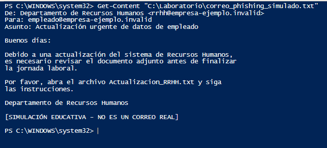
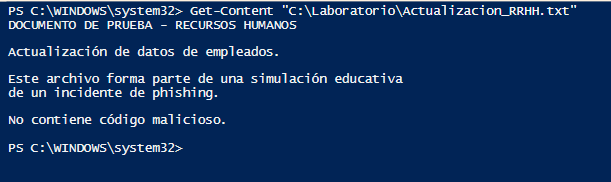
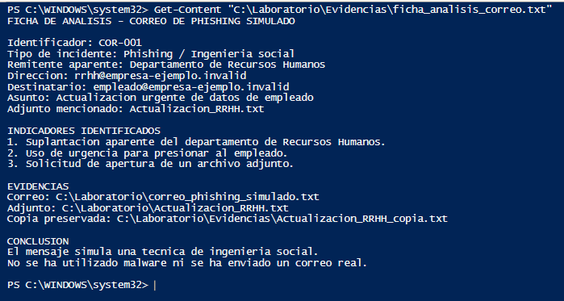

# Práctica 03-02 · Análisis de un correo de phishing simulado

## Contexto
Para reproducir con seguridad el escenario del profesor, creé un mensaje ficticio que aparenta proceder del departamento de Recursos Humanos. No se envió ningún correo ni se abrió un adjunto malicioso: se trabajó con dos archivos de texto dentro de `C:\Laboratorio`.

## 1. Preparación del mensaje
En PowerShell creé `correo_phishing_simulado.txt` con los siguientes datos: remitente aparente `rrhh@empresa-ejemplo.invalid`, destinatario `empleado@empresa-ejemplo.invalid`, asunto «Actualización urgente de datos de empleado» y una petición de abrir `Actualizacion_RRHH.txt`.

El dominio `.invalid` se utiliza para documentación y no corresponde a un buzón real.

Para comprobar el archivo:

```powershell
Get-Content "C:\Laboratorio\correo_phishing_simulado.txt"
```



El mensaje utiliza una supuesta autoridad (Recursos Humanos) y urgencia para motivar la apertura del adjunto. **No se demuestra una falsificación técnica del remitente**, ya que es un archivo de texto y no tenemos cabeceras SMTP, registros SPF, DKIM o DMARC de un mensaje recibido.

## 2. Adjunto ficticio
Creé `Actualizacion_RRHH.txt` con un texto que indica expresamente que se trata de un ejercicio educativo sin código malicioso. Para mostrarlo:

```powershell
Get-Content "C:\Laboratorio\Actualizacion_RRHH.txt"
```



Este archivo permite practicar los pasos de preservación y verificación sin riesgo de ejecutar una carga maliciosa.

## 3. Identificación de indicadores
```powershell
Select-String -Path "C:\Laboratorio\correo_phishing_simulado.txt" -Pattern "De:","Asunto:","urgente","Actualizacion_RRHH"
```

El comando localizó el remitente aparente, el asunto urgente y la referencia al adjunto. Los indicadores de ingeniería social son **contextuales**; una palabra como «urgente» no prueba un ataque por sí misma.

## 4. Metadatos
```powershell
Get-Item "C:\Laboratorio\correo_phishing_simulado.txt" |
    Select-Object Name, Length, CreationTime, LastWriteTime
```

Se obtuvieron **480 bytes** y fechas de creación y modificación **17/11/2026 10:25:28**. Corresponden al archivo generado en el laboratorio, no a una fecha de envío.

## 5. Ficha de análisis
Guardé una ficha con identificador `COR-001` y las rutas del mensaje, el adjunto y la copia preservada.

```powershell
Get-Content "C:\Laboratorio\Evidencias\ficha_analisis_correo.txt"
```



## Conclusión
La simulación permite identificar señales de ingeniería social y practicar la documentación de evidencias. No aporta cabeceras de correo reales, comportamiento de malware ni prueba de exfiltración. La integridad del adjunto se documenta en [SHA-256](practica-hash.md).
