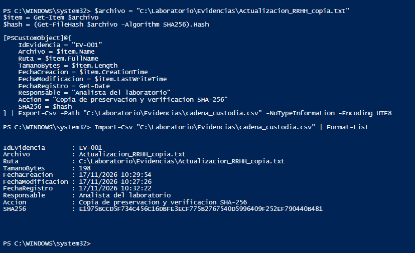

# Práctica 03-03 · Registro inicial de cadena de custodia

## Objetivo
Dejar constancia de qué archivo se preservó, dónde se guardó, cuándo se registró y qué comprobación de integridad se realizó. El ejercicio reproduce **un registro inicial educativo**, no una cadena de custodia judicial completa.

## Evidencia
- **Identificador:** EV-001.
- **Archivo:** `Actualizacion_RRHH_copia.txt`.
- **Origen:** copia de `C:\Laboratorio\Actualizacion_RRHH.txt`.
- **Ruta de preservación:** `C:\Laboratorio\Evidencias\Actualizacion_RRHH_copia.txt`.
- **Tamaño:** 198 bytes.
- **Creación de la copia:** 17/11/2026 10:29:54.
- **Última modificación del contenido:** 17/11/2026 10:27:26.
- **Registro:** 17/11/2026 10:32:22.
- **Responsable indicado:** Analista del laboratorio (rol ficticio).
- **Operación:** copia y verificación SHA-256.

La huella de la copia coincidió con el archivo original:

```text
E1975BCCD5F734C456C16DBFE3ECF775B2767540D5996409F252EF790440B481
```

## Procedimiento
La evidencia se copió antes de consultar sus metadatos:

```powershell
Copy-Item "C:\Laboratorio\Actualizacion_RRHH.txt" "C:\Laboratorio\Evidencias\Actualizacion_RRHH_copia.txt"

Get-Item "C:\Laboratorio\Evidencias\Actualizacion_RRHH_copia.txt" |
    Select-Object Name, FullName, Length, CreationTime, LastWriteTime
```

Después se creó un registro con los datos del archivo y su SHA-256:

```powershell
$archivo = "C:\Laboratorio\Evidencias\Actualizacion_RRHH_copia.txt"
$item = Get-Item $archivo
$hash = (Get-FileHash $archivo -Algorithm SHA256).Hash

[PSCustomObject]@{
    IdEvidencia = "EV-001"
    Archivo = $item.Name
    Ruta = $item.FullName
    TamanoBytes = $item.Length
    FechaCreacion = $item.CreationTime
    FechaModificacion = $item.LastWriteTime
    FechaRegistro = Get-Date
    Responsable = "Analista del laboratorio"
    Accion = "Copia de preservacion y verificacion SHA-256"
    SHA256 = $hash
} | Export-Csv -Path "C:\Laboratorio\Evidencias\cadena_custodia.csv" -NoTypeInformation -Encoding UTF8
```

Finalmente se leyó el CSV:

```powershell
Import-Csv "C:\Laboratorio\Evidencias\cadena_custodia.csv" | Format-List
```



## Observaciones y límites
El registro identifica la copia preservada, pero no documenta todas las personas que pudieran acceder posteriormente ni permite certificar la hora mediante una fuente externa. Para un caso real también serían necesarios controles de acceso, almacenamiento protegido y anotación de cada transferencia o actuación posterior.

## Conclusión
Se generó un primer registro rastreable para la evidencia EV-001. Junto a los dos hashes coincidentes, permite explicar la importancia de la integridad y la trazabilidad durante una investigación, sin atribuirle garantías que una simulación no tiene.
