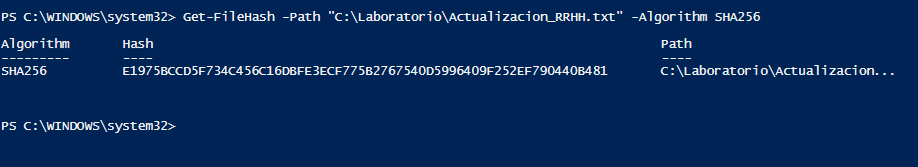
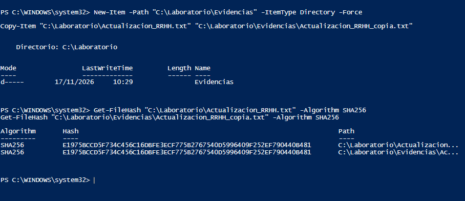

# Práctica 03-01 · Hash SHA-256 y comprobación de integridad

## Objetivo
Calcular la huella SHA-256 del archivo adjunto ficticio y comprobar si una copia conserva exactamente el mismo contenido. Es una práctica de preservación de evidencias aplicable a la investigación del incidente.

**Entorno:** Windows 11, PowerShell, archivo de texto inocuo `C:\Laboratorio\Actualizacion_RRHH.txt`. Fecha: 17/11/2026.

## 1. Hash del adjunto
```powershell
Get-FileHash -Path "C:\Laboratorio\Actualizacion_RRHH.txt" -Algorithm SHA256
```



**Hash obtenido:**

```text
E1975BCCD5F734C456C16DBFE3ECF775B2767540D5996409F252EF790440B481
```

Este hash identifica los bytes del archivo en el momento de la consulta. No sirve para cifrar el contenido ni para demostrar que es seguro.

## 2. Copia de preservación
```powershell
New-Item -Path "C:\Laboratorio\Evidencias" -ItemType Directory -Force
Copy-Item "C:\Laboratorio\Actualizacion_RRHH.txt" "C:\Laboratorio\Evidencias\Actualizacion_RRHH_copia.txt"
```

Tras copiarlo, calculé ambos hashes:

```powershell
Get-FileHash "C:\Laboratorio\Actualizacion_RRHH.txt" -Algorithm SHA256
Get-FileHash "C:\Laboratorio\Evidencias\Actualizacion_RRHH_copia.txt" -Algorithm SHA256
```



**Resultado:** los dos valores SHA-256 coincidían. La copia era idéntica en contenido al original en el momento de la comparación.

## 3. Metadatos de la copia
```powershell
Get-Item "C:\Laboratorio\Evidencias\Actualizacion_RRHH_copia.txt" |
    Select-Object Name, FullName, Length, CreationTime, LastWriteTime
```

Se observaron **198 bytes**, fecha de creación de la copia **17/11/2026 10:29:54** y última modificación **17/11/2026 10:27:26**. La copia puede heredar la fecha de modificación del original mientras recibe una nueva fecha de creación.

## Conclusión
La comparación SHA-256 respalda que no hubo cambios en el contenido entre el original y la copia verificada. Es una comprobación de integridad reproducible, pero **no acredita por sí sola el origen, la autenticidad ni toda la cadena de custodia**. El registro de movimientos se trata en [la práctica de custodia](practica-custodia.md).
