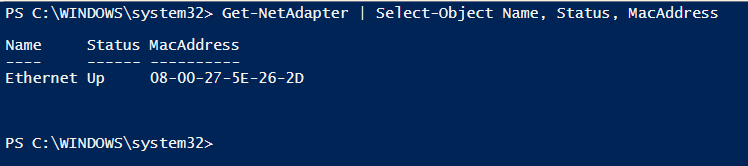
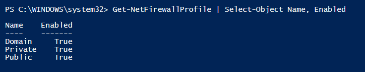
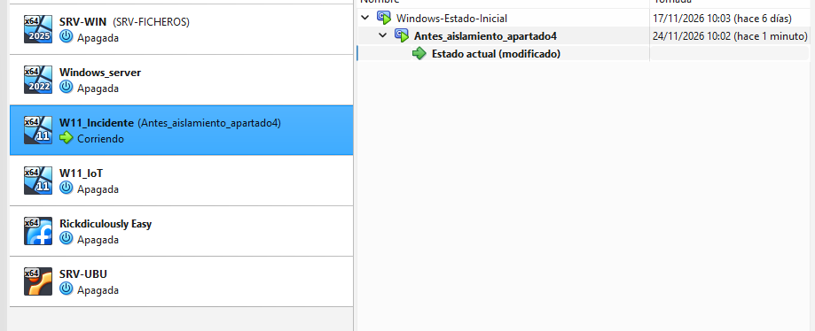
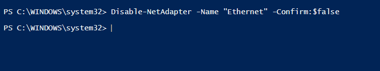
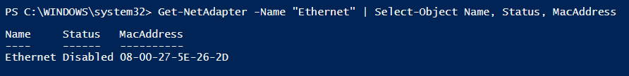
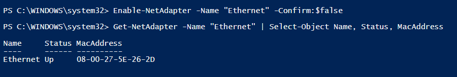
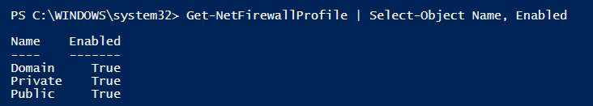

# 04 · Respuesta, recuperación y ciberresiliencia

**Orden de lectura:** prioridades de respuesta → procedimiento o playbook → contención → erradicación y recuperación → ciberresiliencia → conclusión → práctica complementaria. Se distingue lo planificado de lo ejecutado y no se presentan infecciones ni restauraciones de datos ficticias.

## 1. Objetivo y criterios de actuación

Después de que un trabajador abra el adjunto del supuesto mensaje de Recursos Humanos, el enunciado describe alertas antivirus, conexiones externas anómalas y posibles accesos a carpetas compartidas. La prioridad inicial es detener una posible propagación y conservar pruebas sin perjudicar innecesariamente a la empresa.

No debemos presuponer que todo el equipo está infectado ni que ya se han robado datos. En un entorno real, el responsable de respuesta decidiría las medidas en función del riesgo y las evidencias disponibles.

## 2. Procedimiento o *playbook* de respuesta

| Etapa | Qué haría el equipo | Evidencia y resultado esperado |
|---|---|---|
| Identificación | Registrar alerta, hora, equipo, cuenta, correo y síntomas | Abrir INC-2026-001 y establecer severidad provisional |
| Contención inmediata | Aislar el puesto si existe riesgo de propagación, protegiendo la adquisición de pruebas | Registrar decisión, responsable y momento |
| Contención de cuentas | Valorar revocación de sesiones, cambio de credenciales y MFA | Limitar nuevos accesos no autorizados |
| Contención de red | Examinar destinos, bloquear indicadores verificados y revisar accesos SMB | Reducir comunicaciones dañinas sin bloquear servicios legítimos |
| Erradicación | Identificar y eliminar el mecanismo malicioso, corregir la causa y revisar otros equipos | Descartar persistencia y puntos de entrada |
| Recuperación | Restaurar desde una copia íntegra o equipo limpio; revisar sistemas y accesos | Volver al servicio de forma controlada |
| Seguimiento | Vigilar alertas, conexiones, registros y nuevas incidencias | Confirmar que el problema no reaparece |
| Lecciones aprendidas | Actualizar controles, formación y procedimientos | Disminuir impacto de incidentes futuros |

## 3. Contención y precauciones

Ante sospecha fundada de actividad maliciosa, una medida habitual es desconectar de la red el equipo afectado, preservando el estado necesario para la investigación. No se debe apagar automáticamente si se necesita recoger información volátil; esa decisión requiere valorar la urgencia y coordinar al equipo técnico.

Los bloqueos de IP o dominio deben fundamentarse en indicadores comprobados: **en este laboratorio todavía no se ha identificado una IP remota maliciosa real**. Tampoco se propone borrar el adjunto o formatear el equipo sin recoger antes las evidencias pertinentes.

Si las credenciales pudieran haberse expuesto, se revisarán sesiones, tokens, privilegios y accesos recientes. En los recursos compartidos se contrastarán permisos y registros; el puerto 445 abierto por sí solo no justifica dar por confirmado el movimiento lateral.

## 4. Erradicación y recuperación: cómo comprobar que el servicio vuelve

En el escenario, tras preservar las evidencias se revisaría el origen de la infección, las tareas y servicios persistentes, las cuentas, las actualizaciones y la seguridad de los servidores compartidos. La recuperación debería realizarse desde un estado confiable, restaurando únicamente información verificada.

La comprobación de recuperación debe incluir inicio de sesión autorizado, funcionamiento de las aplicaciones esenciales, permisos a recursos compartidos, estado del antivirus y firewall, ausencia de alertas relevantes y supervisión posterior. Una restauración sin verificaciones no permite dar por cerrado el incidente.

## 5. Ciberresiliencia

- **Anticipación:** identificar activos críticos, riesgos de phishing, dependencias y responsables; formar a los trabajadores y disponer de copias.
- **Resistencia:** segmentar accesos y limitar privilegios para que el fallo de un puesto no comprometa toda la organización.
- **Recuperación:** mantener copias verificadas y planes para reconstruir equipos y restablecer servicios.
- **Evolución:** convertir las lecciones del incidente en cambios de configuración, procedimientos y formación.

Se deben priorizar los servicios de mayor impacto y acordar con dirección los tiempos aceptables de recuperación, sin prometer que siempre podrá restablecerse todo inmediatamente.

## 6. Conclusión del procedimiento

El procedimiento propuesto combina rapidez con preservación de evidencias. En el laboratorio **sí se ha ejecutado y revertido un aislamiento del adaptador de red**; la práctica, sus comprobaciones y sus límites se documentan a continuación. No se ha erradicado malware ni restaurado información desde una copia de seguridad, pues no había una infección real confirmada que justificase esas actuaciones.

**Referencia docente:** [implementación de medidas, procedimientos, playbooks y ciberresiliencia](https://www.jesusninoc.com/09/30/incidentes-de-ciberseguridad/).

## 7. Práctica complementaria: contención y recuperación de red en Windows 11

Se utilizó la máquina virtual **`W11_Incidente`**, con Windows 11 Pro en VirtualBox, para realizar una simulación segura de aislamiento temporal de red. Se trabajó sobre el adaptador `Ethernet` y se verificó posteriormente su recuperación. **Son comprobaciones reales del laboratorio, no hechos del incidente ficticio ni una erradicación de malware.**

### 7.1. Comprobación inicial del adaptador

```powershell
Get-NetAdapter | Select-Object Name, Status, MacAddress
```



El adaptador `Ethernet` figuraba en estado **`Up`** y mostró la dirección MAC `08-00-27-5E-26-2D`. Este resultado sirvió como referencia antes de la contención.

### 7.2. Estado inicial del firewall

```powershell
Get-NetFirewallProfile | Select-Object Name, Enabled
```



Los perfiles **Domain**, **Private** y **Public** devolvieron `True` en la propiedad `Enabled`. La comprobación refleja la configuración de los perfiles, no una prueba de que no existan amenazas.

### 7.3. Punto de recuperación en VirtualBox



Antes de desactivar el adaptador se creó la instantánea **`Antes_aislamiento_apartado4`**, el 24/11/2026. Este punto de retorno reduce el riesgo de la práctica; **no equivale a restaurar archivos empresariales desde una copia verificada**.

### 7.4. Aislamiento temporal del equipo

Desde PowerShell, ejecutado como administrador dentro de la máquina virtual:

```powershell
Disable-NetAdapter -Name "Ethernet" -Confirm:$false
```



El comando volvió al indicador de PowerShell sin mostrar errores. Para acreditar el cambio se realizó una consulta adicional del estado del adaptador.

### 7.5. Verificación de la contención

```powershell
Get-NetAdapter -Name "Ethernet" | Select-Object Name, Status, MacAddress
```



El adaptador apareció en estado **`Disabled`**, manteniendo la dirección MAC indicada inicialmente. Esto confirma la desactivación de la interfaz desde Windows durante la prueba; no se ha demostrado un incidente malicioso ni un aislamiento de toda una organización.

### 7.6. Restauración del adaptador y verificación

```powershell
Enable-NetAdapter -Name "Ethernet" -Confirm:$false
Get-NetAdapter -Name "Ethernet" | Select-Object Name, Status, MacAddress
```



Tras habilitar de nuevo la interfaz, la consulta mostró **`Up`**, con la misma dirección MAC. Se recuperó el estado activo del adaptador; esta comprobación **no implica por sí sola que se haya verificado conectividad extremo a extremo o acceso a servicios externos**.

### 7.7. Comprobación final del firewall

```powershell
Get-NetFirewallProfile | Select-Object Name, Enabled
```



Los tres perfiles (**Domain**, **Private** y **Public**) seguían mostrando `Enabled = True`. Se constató que no quedaron deshabilitados tras la desactivación y reactivación del adaptador.

### 7.8. Resultado y límites de la práctica

La secuencia **estado inicial → instantánea → aislamiento → verificación → reactivación → comprobación final** permitió ejercitar una medida básica de contención reversible. No se realizó un análisis de eliminación de malware, una restauración de información desde copias, una prueba de acceso a aplicaciones empresariales ni una investigación de exfiltración. Estas tareas siguen descritas como actuaciones que corresponderían a un incidente real, sin atribuirles resultados no observados.
