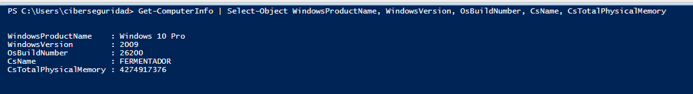
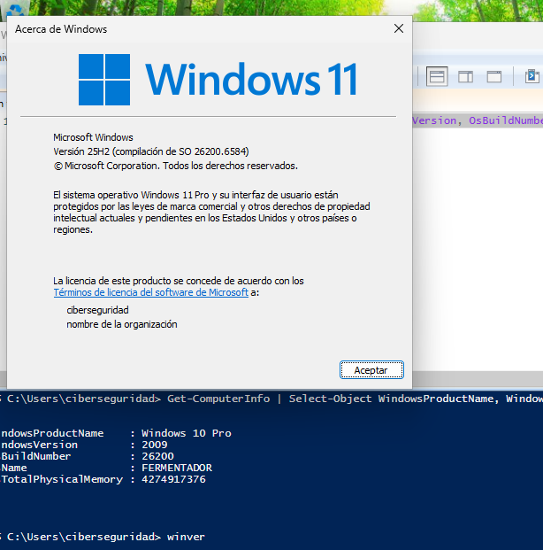

# Práctica 00 · Preparación y auditoría inicial de Windows 11

## Objetivo
Antes de reproducir el incidente de phishing, preparé una máquina virtual con Windows 11 y comprobé qué información podía obtener con las herramientas que trae el propio sistema. La idea es conocer el estado inicial y no confundir los eventos anteriores con los hechos de la simulación.

**Entorno:** VirtualBox, máquina `W11_Incidente`, Windows 11 Pro, PowerShell. Fecha de las pruebas: **17/11/2026**. Nombre mostrado por Windows: `FERMENTADOR`. En este momento no se ha documentado todavía la instalación de Ubuntu ni el aislamiento definitivo de la red.

> **Capturas:** las imágenes originales están conservadas en el ZIP local del laboratorio. Las rutas Markdown de este documento apuntan a `capturas/`; quedarán visibles en GitHub cuando se incorporen los archivos de imagen.

## Identificación del sistema
Ejecuté:

```powershell
Get-ComputerInfo | Select-Object WindowsProductName, WindowsVersion, OsBuildNumber, CsName, CsTotalPhysicalMemory
```



La salida indicó una compilación **26200**, memoria próxima a **4 GB** y nombre de equipo `FERMENTADOR`. Aunque `WindowsProductName` mostraba «Windows 10 Pro», se confirmó que el sistema utilizado era Windows 11 Pro; este dato ilustra por qué conviene contrastar los campos de identificación.

La versión se revisó también mediante:

```powershell
winver
```



## Estado inicial de Microsoft Defender
```powershell
Get-MpComputerStatus | Select-Object AMServiceEnabled, AntivirusEnabled, RealTimeProtectionEnabled, AntivirusSignatureLastUpdated
```


Esta consulta sirve para verificar el servicio antivirus y la protección en tiempo real; no sustituye una prueba de detección. Se conserva la salida real en la captura, en lugar de atribuirle valores que no se han transcrito a este documento.

## Firewall de Windows
```powershell
Get-NetFirewallProfile | Select-Object Name, Enabled, DefaultInboundAction, DefaultOutboundAction
```


Los tres perfiles, **Domain, Private y Public**, estaban activados (`Enabled = True`). Los campos de acción predeterminada aparecían como `NotConfigured`; esto **no** equivale a que el tráfico esté permitido.

## Registro de seguridad
En una primera consulta recibí un error de permisos. Al abrir PowerShell **como administrador**, ejecuté:

```powershell
Get-WinEvent -ListLog Security | Select-Object LogName, IsEnabled, RecordCount, MaximumSizeInBytes
```


El registro `Security` estaba habilitado, con **14.327 eventos** y un tamaño máximo configurado de **20 MB**. El número de eventos es una observación puntual; cambia con el uso del sistema.

### Inicios de sesión correctos: 4624
```powershell
Get-WinEvent -FilterHashtable @{LogName='Security'; Id=4624} -MaxEvents 5 |
    Select-Object TimeCreated, Id, Message
```


Se consultaron cinco eventos del 17/11/2026. El identificador 4624 registra autenticaciones correctas, incluidas algunas realizadas por servicios; no equivale siempre a un usuario entrando manualmente al equipo.

### Intentos fallidos: 4625
```powershell
Get-WinEvent -FilterHashtable @{LogName='Security'; Id=4625} -MaxEvents 5 |
    Select-Object TimeCreated, Id, Message
```


Aparecieron cuatro eventos de fechas anteriores: tres del **30/10/2026** y uno del **26/10/2026**. No podemos considerarlos parte del incidente simulado, creado semanas después.

Para profundizar consulté un evento:

```powershell
Get-WinEvent -FilterHashtable @{LogName='Security'; Id=4625} -MaxEvents 1 |
    Format-List TimeCreated, Id, Message
```


El evento del 30/10/2026 mostró un inicio de sesión de **tipo 2**, cuenta `ciberseguridad`, estado `0xC000006D` y subestado `0xC000006A` (contraseña incorrecta). La dirección registrada era `127.0.0.1`, de bucle local. **No hay base para afirmar que se tratara de un ataque externo.**

## Puertos, procesos y servicios
Primero consulté conexiones establecidas, sin resultados en ese instante:

```powershell
Get-NetTCPConnection -State Established |
    Select-Object LocalAddress, LocalPort, RemoteAddress, RemotePort, OwningProcess
```

Después consulté todos los estados:

```powershell
Get-NetTCPConnection |
    Select-Object LocalAddress, LocalPort, RemoteAddress, RemotePort, State, OwningProcess |
    Format-Table -AutoSize
```


Se observaron puertos en escucha, entre ellos **135 (RPC), 139 (NetBIOS), 445 (SMB)** y **5040**, y una dirección local `10.10.10.30`. SMB resulta relevante porque el enunciado menciona accesos a recursos compartidos, pero un puerto en escucha **no prueba** una intrusión.

Para identificar el proceso y servicio del puerto 5040:

```powershell
Get-Process -Id 2692 | Select-Object Id, ProcessName, Path
Get-CimInstance Win32_Service | Where-Object {$_.ProcessId -eq 2692} |
    Select-Object Name, DisplayName, State, ProcessId
```

El PID observado **2692** correspondía a `svchost.exe` en `C:\WINDOWS\system32\` y al servicio **CDPSvc**, «Servicio de plataforma de dispositivos conectados», en ejecución. Los PID son temporales y pueden variar entre arranques.

## Conclusiones
Esta práctica permitió comprobar que el sistema dispone de registros auditables y herramientas nativas para observar conexiones y procesos. Los eventos obtenidos reflejan el estado **previo** del laboratorio, no el ataque del caso. La configuración de Ubuntu, la red aislada y las pruebas entre máquinas siguen pendientes.

**Instantánea:** se creó `Windows-Estado-Inicial` en VirtualBox para facilitar la recuperación del laboratorio. No se incluye una captura adicional porque las evidencias principales se han centrado en resultados técnicos.
